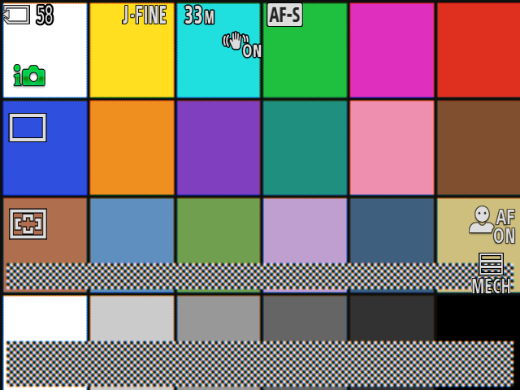
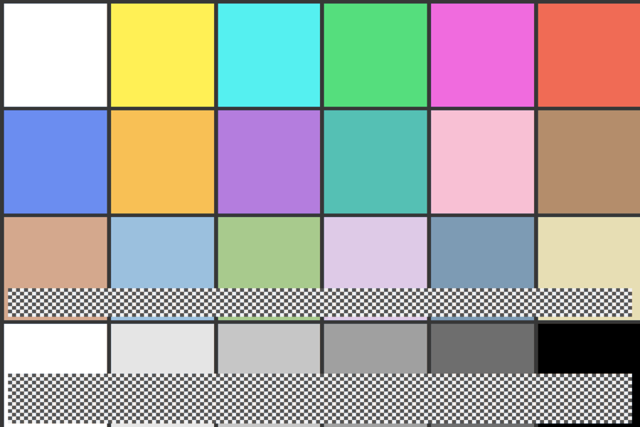
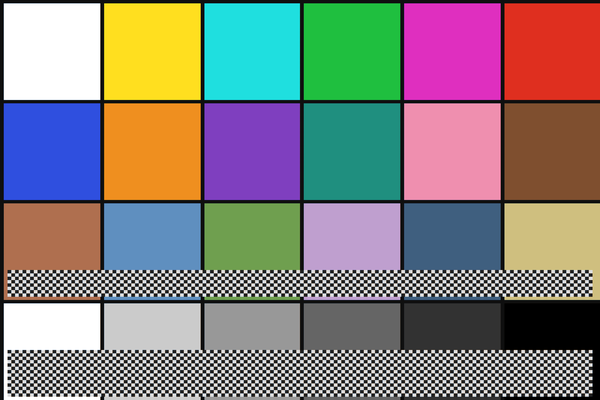

# A7C II QEMU 模拟器

在 Linux 电脑上运行 Sony A7C II（ILCE-7CM2）的原厂固件，用相机外观的窗口操作原厂界面、按键和拨盘，方便研究相机软件，无需连接真实相机。

默认窗口提供原厂界面、菜单、机身按键和虚拟存储。33 MP JPEG 与未压缩 RAW 写卡使用独立的实验配置，尚未接入默认窗口。



这是 QEMU RAMFB 的直接截图。实验预览由 `MENU_VIRTUAL_PREVIEW=functional-cmos-chart-v1` 显式开启，在原厂 HUD 透明层后合成虚拟色卡，不修改原始 OSD。它是软件预览，不模拟原 CP 的 YC 视频通路或物理 ISP。

**独立运行产品：外部只需自己的 `BODYDATA.DAT` 和 QEMU 11.1.2 源码归档。** 相机运行代码、虚拟设备、资源导入和构建入口均在本仓库；不需要 `a7c2-re`、系统 dump 或历史实验目录。

## 能做什么

- **运行原厂程序**：从自己的 2.01 ALLLANG `BODYDATA.DAT` 导入相机程序和内核。
- **查看原厂界面**：显示相机 LCD，可用简体中文完成首设并浏览菜单。
- **LCD 触屏**：在画面内用鼠标左键点击或拖动，也支持 GDK 单指触摸。不支持多指手势。见[触屏用法](report/2026-11-11-touchscreen/README.md)。
- **操作机身控制**：窗口提供主要按键和拨盘。连续 LCD 与输入使用独立队列；输入由常驻发送器送到原厂应用，保留按下与释放事件。见[输入和显示实现](docs/tech/2026-11-07-low-latency.md)。
- **使用虚拟 SD 卡**：原冷启动默认创建 1 GiB FAT16 虚拟卡，支持安全拔出、重新插入，以及正常关闭后的卡镜像保存。
- **保留部分设置**：可以跨启动保留语言和日期格式；首次设置仍可能再次出现。
- **修改运行环境**：用 `overwrite/` 替换程序或库，或用“固件开发”面板切换替代文件与原版，并从 guest 读回文件属性和摘要。

## 虚拟 CMOS 与静态照片

实验配置 `functional-ram-card-independent-internal-v1` 使用[虚拟 CMOS](report/virtual-sensor/README.md)生成 GRBG Bayer 色卡，显示帧为 640×480，L 尺寸照片为 7008×4672。固件负责 JPEG 编码、ARW 封装和 Fsys 写卡。未压缩 RAW 在原厂菜单选择 `RAW-only`、`L` 和 `UNCOMPRESS`，输出到虚拟卡的 `DCIM/100MSDCF/`。



上图为虚拟卡中 `DSC00001.ARW` 经 LibRaw 解码后缩至 900×600 的预览。ARW 使用 `Compression=1`，以小端 16 位容器保存 14 位 GRBG 样本，行跨度为 14,016 字节。图中两条黑白横带是色卡的细节图案。

RAW 模式可以在宿主和 guest 之间使用无损 RLE 传送 RGB 帧，guest 还原完整像素后再交给原厂消费者。RLE 不改变 ARW 的未压缩格式，也不模拟相机内部总线。

[](docs/images/virtual-cmos-color-chart.png)

[完整 7008×4672 色卡](docs/images/virtual-cmos-color-chart.png)由宿主传感器模型直接生成，是输入场景示意，不是固件写卡成片。

RAW 写卡后的资源清理仍属于实验范围。RAW＋JPEG、其他 RAW 压缩模式和录像写卡不在当前支持范围内。

## 怎么运行

需要 Linux x86_64、Python 3.12+ 和 X11／Xwayland 桌面。建议准备 32 GiB 内存和至少 20–30 GiB 可用磁盘，使用普通用户运行，系统需允许 bubblewrap 使用用户命名空间。

先准备：

1. 自己的 **ILCE-7CM2 2.01 ALLLANG `BODYDATA.DAT`**。其它版本暂不支持，仓库不提供 Sony 固件。
2. [QEMU 11.1.2 源码归档](https://download.qemu.org/qemu-11.1.2.tar.xz)，放到 `source/vendor/qemu-11.1.2.tar.xz`。校验信息见[源码下载说明](source/vendor/README.md)。
3. Python 图形、加密依赖和编译工具。下面的检查脚本会列出缺少的命令、模块和开发库；Python 构建环境还需要 pip、setuptools 和 wheel。

在仓库目录执行：

```bash
./tools/check-host.sh
python3 tools/check-source.py
./start.sh --bodydata /path/to/BODYDATA.DAT --prepare-only
./build-qemu.sh
./start.sh --bodydata /path/to/BODYDATA.DAT
```

把 `/path/to/BODYDATA.DAT` 换成自己的固件路径。脚本不会自动下载源码或安装依赖。

窗口出现后按 **ON**，等待启动并完成相机的语言、日期等提示。启动失败、停在教程或显示“系统出错”时，可以先查看[启动排障文档](docs/tech/README.md)。

默认相机启动现在选择已有的 `virtual-rom-v1` 虚拟蓝牙控制器，让原 BSA 完成管理初始化，无需额外设置环境变量，见[默认启动修复记录](docs/tech/2026-11-08-default-startup.md)。它只模拟有限控制器行为，不提供真实无线或手机配对。原系统错误页没有被屏蔽；后续黑帧与完整唤醒仍待修复。

仅在排查原蓝牙依赖时，可以显式禁用该模型作对照：

```bash
A7C2_VIRTUAL_HCI= ./start.sh --bodydata /path/to/BODYDATA.DAT
```

禁用后原蓝牙初始化可能失败并显示“系统出错”；原配置不会因选择这个对照而重置。

第一次导入和编译完成后，后续只需：

```bash
./start.sh --bodydata /path/to/BODYDATA.DAT
```

也可以把固件放到 `incoming/bodydata/BODYDATA.DAT`，以后直接执行 `./start.sh`。

## 原 init 冷启动

默认 `./start.sh` 和窗口 ON 使用原用户态冷启动：从官方包的原 RAM0 运行原 init，经过 p7 根挂载、pivot/chroot、原 init2，再启动原相机程序。原有兼容路线仍可显式选择：

```bash
./start.sh --boot-profile direct-bootin
```

独立 CLI 实验入口保留。准备好上面的产品资产后执行：

```bash
python3 tools/run-original-cold.py --new-instance \
  --output runtime/diagnostics/my-original-cold --seconds 180
```

CLI 创建专属内部盘，输出目录必须不存在。窗口默认使用自己的持久内部盘。原 BootROM、loader、CP、WBI 和完整硬件上电仍未完成，详见[原冷启动复现](docs/tech/2026-11-09-original-cold-boot.md)与[窗口集成记录](docs/tech/2026-11-09-original-cold-window.md)。

## 虚拟卡和设置

新原 cold 默认卡为 **1 GiB**；使用非零种子时，不会把整卡额外装入 initrd。见[虚拟 SD 专题](docs/tech/2026-11-10-1g-sd.md)。

关机时按 **OFF** 或关闭窗口，等待保存完成。默认虚拟卡保存为：

```text
runtime/analysis/menu-runs/run-*/SD/card.img
```

下次继续使用某张卡时，指定它的路径：

```bash
./start.sh --bodydata /path/to/BODYDATA.DAT \
  --sd-image /path/to/previous-run/SD/card.img
```

原冷启动的相机设置保存在同一内部盘的 `/setting`，保存时另有 `runtime/analysis/camera-instances/default/` 的已校验快照。旧内存路线的快照只迁入内部盘一次；以后保留盘上实际值。完整设置持久化尚未验证。虚拟卡需要通过 `--sd-image` 手动选择；同一窗口内的重启自动沿用刚保存的卡。

运行中可以点击 **安全拔出 SD**，等窗口确认卡已拔出，再点击 **插入 SD**。目前只能重插同一张虚拟卡，还不能在运行中换选另一张镜像。

如果保存失败，窗口会保留运行实例和错误信息。请先处理错误，再关闭相关进程，避免丢失尚未保存的数据。

## 内部持久磁盘与固件开发

窗口的“固件开发”面板提供文件测试、启动测试和更新三个区域。要保留会话，可在停机状态选择 RAM 模式，再按 **ON**。保存 RAM 并退出后，可用同一内部盘恢复。见[窗口 RAM 模式](docs/tech/2026-11-09-window-ram.md)。RAM 恢复不是原厂 WBI；完整 BODYDATA 更新尚不支持。

原冷启动默认使用并保留内部持久磁盘。兼容路线可以在停止 VM 后勾选“使用内部持久磁盘”，或者执行：

```bash
./start.sh --boot-profile direct-bootin --persistent-storage
```

第一次会从自己的官方 BODYDATA 缓存创建单个内部磁盘文件，容量和19个卷的布局由官方分区表决定；用户区与两个 boot 区总计 1,962,934,272 字节。生成物保存在 `runtime/analysis/persistent-storage/`，已有实例不会在重启时重铺。只使用普通虚拟磁盘文件。

持久盘文件测试当前支持 `/usr` 下的程序或库：保存退出后选择文件和目标路径，ON 后点击读回检查；必须看到实际 guest 的完整摘要、长度与 root 字段匹配。选择“原版”后再次启动会把对应目标恢复为包内原文件。见[开发与存储说明](docs/tech/2026-11-08-development-and-storage.md)。完整设置持久化尚不支持。

显式 USB 配置可在本机枚举 Sony USB 设备并通过 jiritsu 访问 guest。普通相机菜单中的 USB 启动和 MSC 尚未接通；配置与限制见 [USB 专题](docs/tech/2026-11-09-usb-jiritsu.md)。

## 替换程序或库

将修改后的文件放进 `overwrite/`，按相机内的路径排列。例如替换 `/usr/lib/appFw.so`：

```text
overwrite/
└── usr/
    └── lib/
        └── appFw.so
```

正常执行 `./start.sh` 就会加载这些文件。也可以指定另一个覆盖目录：

```bash
./start.sh --bodydata /path/to/BODYDATA.DAT \
  --overwrite-dir /path/to/my-overwrite
```

覆盖目录只接受普通文件和目录，不支持符号链接。原冷启动只接受包内已有、可恢复的 `/usr` 文件；修改写入当前虚拟内部盘，原始固件文件保持只读。恢复原版时，在停止后使用开发面板的“原版”再启动并读回；仅移走覆盖文件不会撤销已持久化的改动。兼容路线的非持久模式仍仅修改派生启动镜像。

替换不兼容的程序或库可能导致启动失败。

## 技术文档

- [开发面板与单盘集成](docs/tech/2026-11-08-development-and-storage.md)：文件替换、启动与存储实现。
- [原 init 冷启动](docs/tech/2026-11-09-original-cold-boot.md)：从原 RAM0 经 `init`、根挂载和 `init2` 到相机应用的启动路径。
- [图像源与显示配置](docs/tech/functional-source-and-display.md)：软件成像、显示与实验配置。
- [启动排障与技术笔记](docs/tech/README.md)：固件导入、显示、输入、存储和成像。
- [验证记录](validation/README.md)与[源码来源](SOURCES.md)、[第三方许可](THIRD-PARTY.md)。

固件、私有设置、虚拟卡和运行时生成的二进制均不随源码分发。
