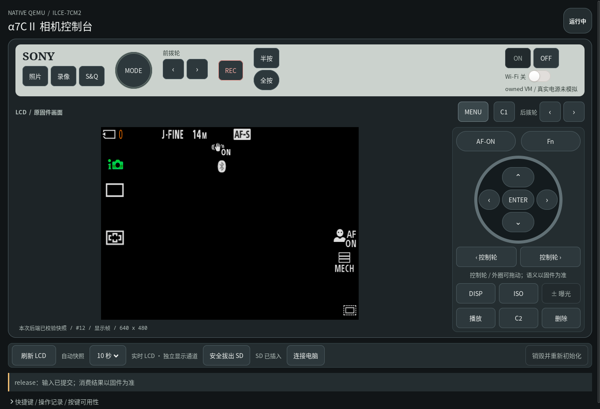

# A7C II QEMU 模拟器

在 Linux 电脑上运行 Sony A7C II（ILCE-7CM2）的原厂固件，用相机外观的窗口操作原厂界面、按键和拨盘，方便研究相机软件，无需连接真实相机。

**目前能操作菜单，还不能拍照或录像。取景区域仍是黑色，首次启动也可能停在设置、教程或错误页面。**



上图记录 2026-11-08 直接执行当时默认 `./start.sh` 的 direct-bootin 实际窗口，没有传入 HCI 环境变量。已完成原首设、拍摄主界面、中文菜单进入与返回，未出现“系统出错”，原配置没有重置；[验收收据](validation/default-startup-20261108.json)记录原帧、原事件及正常保存退出。取景和拍摄成片尚未恢复，长期电源/黑帧唤醒仍在完善。此前的[原语言页](docs/images/startup-window-20261107.png)和[显式模型首轮HUD](docs/images/native-shooting-20261107.png)保留。运行只用 2.01 ALLLANG BODYDATA 与固定 QEMU 源码构建，不依赖研究仓库或系统 dump。

**独立运行产品：外部只需自己的 `BODYDATA.DAT` 和 QEMU 11.1.2 源码归档。** 相机运行代码、虚拟设备、资源导入和构建入口均在本仓库；不需要 `a7c2-re`、系统 dump 或历史实验目录。

## 能做什么

- **运行原厂程序**：从自己的 2.01 ALLLANG `BODYDATA.DAT` 导入相机程序和内核。
- **查看原厂界面**：显示相机的 LCD 画面，可以选择简体中文、浏览菜单。拍摄主界面已有短时运行验证，完整启动和长期稳定性仍在完善。
- **操作机身控制**：窗口提供主要按键、拨盘和触摸操作。连续 LCD 已与输入队列分开，原 App32 使用常驻发送器；本轮 12 个真实窗口样本中位数 97.3ms，最大 121.1ms，严格 100ms 目标尚未全过。原按压/释放与完整帧校验保留，[实现和验证范围](docs/tech/2026-11-07-low-latency.md)。拍摄相关功能还没有全部接通。
- **使用虚拟 SD 卡**：原厂程序可以写入相机数据库等文件，支持安全拔出、重新插入，以及正常关闭后的卡镜像保存。
- **保留部分设置**：语言和日期格式已验证可以跨次启动恢复。全部设置、首次设置完成状态还没有完整保存，重新启动时可能再次出现首设。
- **修改运行环境**：可以用 `overwrite/` 替换本次运行使用的程序或库，或在“固件开发”中暂存文件、选择下次使用原版，并核对实际 guest 的完整文件摘要、长度和权限。已有原 AP 文件读回与正常保存退出验证，见[验收收据](validation/firmware-file-native-20261108.json)。

虚拟感光元件、软件镜头、对焦和 JPEG／H.264 编码已经有实现，也完成了组件测试。当前正在把这些设备接入原厂程序的拍摄流程，让它真正取得图像、编码并写入虚拟卡。**现在还没有由原厂程序拍下并保存的 JPG 或 MP4。**

## 怎么运行

需要 Linux x86_64、Python 3.12+ 和 X11／Xwayland 桌面。建议准备 32 GiB 内存和至少 20–30 GiB 可用磁盘，使用普通用户运行，系统需允许 bubblewrap 使用用户命名空间。

先准备：

1. 自己的 **ILCE-7CM2 2.01 ALLLANG `BODYDATA.DAT`**。其它版本暂不支持，仓库不提供 Sony 固件。
2. [QEMU 11.1.2 源码归档](https://download.qemu.org/qemu-11.1.2.tar.xz)，放到 `source/vendor/qemu-11.1.2.tar.xz`。校验信息见[源码下载说明](source/vendor/README.md)。
3. Python 图形、加密依赖和编译工具。下面的检查脚本会列出缺少的命令、模块和开发库；Python 构建环境还需要 pip、setuptools 和 wheel。

在仓库目录执行：

```bash
./tools/check-host.sh
python3 tools/check-source.py
./start.sh --bodydata /path/to/BODYDATA.DAT --prepare-only
./build-qemu.sh
./start.sh --bodydata /path/to/BODYDATA.DAT
```

把 `/path/to/BODYDATA.DAT` 换成自己的固件路径。脚本不会自动下载源码或安装依赖。

窗口出现后按 **ON**，等待启动并完成相机的语言、日期等提示。启动失败、停在教程或显示“系统出错”时，可以先查看[启动排障文档](docs/tech/README.md)。

默认相机启动现在选择已有的 `virtual-rom-v1` 虚拟蓝牙控制器，让原 BSA 完成管理初始化，无需额外设置环境变量，见[默认启动修复记录](docs/tech/2026-11-08-default-startup.md)。它只模拟有限控制器行为，不提供真实无线或手机配对。原系统错误页没有被屏蔽；后续黑帧与完整唤醒仍待修复。

仅在排查原蓝牙依赖时，可以显式禁用该模型作对照：

```bash
A7C2_VIRTUAL_HCI= ./start.sh --bodydata /path/to/BODYDATA.DAT
```

禁用后原蓝牙初始化可能失败并显示“系统出错”；原配置不会因选择这个对照而重置。

第一次导入和编译完成后，后续只需：

```bash
./start.sh --bodydata /path/to/BODYDATA.DAT
```

也可以把固件放到 `incoming/bodydata/BODYDATA.DAT`，以后直接执行 `./start.sh`。

当前无参数 `./start.sh` 已在独立产品副本实际完成原 init 冷启动、中文首设、HUD、原菜单往返和保存退出；首个合成 LCD 改用原启动预算的剩余时间，避免固定 15 秒过早失败。见[默认入口实跑与修复](docs/tech/2026-11-09-default-cold-entry.md)及[收据](validation/default-original-cold-entry-20261109.json)。此前 direct-bootin 默认入口的记录保留在[2026-11-08 收据](validation/default-after-integration-20261108.json)，文件测试和同盘恢复见[窗口集成记录](docs/tech/2026-11-09-original-cold-window.md)。

## 原 init 冷启动

默认 `./start.sh` 和窗口 ON 使用原用户态冷启动：从官方包的原 RAM0 运行原 init，经过 p7 根挂载、pivot/chroot、原 init2，再启动原相机程序。原有兼容路线仍可显式选择：

```bash
./start.sh --boot-profile direct-bootin
```

独立 CLI 实验入口保留。准备好上面的产品资产后执行：

```bash
python3 tools/run-original-cold.py --new-instance \
  --output runtime/diagnostics/my-original-cold --seconds 180
```

CLI 创建专属内部盘，输出目录必须不存在。窗口默认使用自己的持久内部盘；CLI 与窗口分别验收。原 BootROM、loader、CP、WBI 和完整硬件上电仍未完成，详见[原冷启动复现](docs/tech/2026-11-09-original-cold-boot.md)与[窗口集成记录](docs/tech/2026-11-09-original-cold-window.md)。

## 虚拟卡和设置

关机时按 **OFF** 或关闭窗口，等待保存完成。默认虚拟卡保存为：

```text
runtime/analysis/menu-runs/run-*/SD/card.img
```

下次继续使用某张卡时，指定它的路径：

```bash
./start.sh --bodydata /path/to/BODYDATA.DAT \
  --sd-image /path/to/previous-run/SD/card.img
```

原冷启动的相机设置保存在同一内部盘的 `/setting`，保存时另有 `runtime/analysis/camera-instances/default/` 的已校验快照。旧内存路线的快照只迁入内部盘一次；以后保留盘上实际值。完整设置持久化尚未验证。虚拟卡需要通过 `--sd-image` 手动选择；同一窗口内的重启自动沿用刚保存的卡。

运行中可以点击 **安全拔出 SD**，等窗口确认卡已拔出，再点击 **插入 SD**。目前只能重插同一张虚拟卡，还不能在运行中换选另一张镜像。

如果保存失败，窗口会保留运行实例和错误信息。请先处理错误，再关闭相关进程，避免丢失尚未保存的数据。

## 内部持久磁盘与固件开发

窗口的“固件开发”面板提供文件测试、启动测试和更新三个区域。完整 BODYDATA 更新按本轮范围暂缓；保留 RAM 的热恢复尚未接入。

原冷启动默认使用并保留内部持久磁盘。兼容路线可以在停止 VM 后勾选“使用内部持久磁盘”，或者执行：

```bash
./start.sh --boot-profile direct-bootin --persistent-storage
```

第一次会从自己的官方 BODYDATA 缓存创建单个内部磁盘文件，容量和19个卷的布局由官方分区表决定；用户区与两个 boot 区总计 1,962,934,272 字节。生成物保存在 `runtime/analysis/persistent-storage/`，已有实例不会在重启时重铺。只使用普通虚拟磁盘文件。

持久盘文件测试当前支持 `/usr` 下的程序或库：保存退出后选择文件和目标路径，ON 后点击读回检查；必须看到实际 guest 的完整摘要、长度与 root 字段匹配。选择“原版”后再次启动会把对应目标恢复为包内原文件。内部卷的重启与关闭结果见[开发与存储验收](docs/tech/2026-11-08-development-and-storage.md)。全部设置持久化仍未验证。

[官方启动流程复核](docs/tech/2026-11-08-boot-review.md)保留此前路线的差异。原 init/pivot 用户态冷链现已接到窗口 ON；原冷启动下的旧逻辑配置复位暂禁用，盘上设置保持。热 WBI 恢复仍未完成。显式 Sony USB 候选已通过本机宿主 `054c:0336` 枚举、配置1／4个端点、原 jiritsu 七步认证及同轮保存退出；复现与边界见[USB报告](docs/tech/2026-11-09-usb-jiritsu.md)和[收据](validation/usb-jiritsu-20261109.json)。普通 AP 菜单 USB 启动、同 USB 的版本／root 读取仍未完成。

## 替换程序或库

将修改后的文件放进 `overwrite/`，按相机内的路径排列。例如替换 `/usr/lib/appFw.so`：

```text
overwrite/
└── usr/
    └── lib/
        └── appFw.so
```

正常执行 `./start.sh` 就会加载这些文件。也可以指定另一个覆盖目录：

```bash
./start.sh --bodydata /path/to/BODYDATA.DAT \
  --overwrite-dir /path/to/my-overwrite
```

覆盖目录只接受普通文件和目录，不支持符号链接。原冷启动只接受包内已有、可恢复的 `/usr` 文件；修改写入当前虚拟内部盘，原始固件文件保持只读。恢复原版时，在停止后使用开发面板的“原版”再启动并读回；仅移走覆盖文件不会撤销已持久化的改动。兼容路线的非持久模式仍仅修改派生启动镜像。

替换不兼容的程序或库可能导致启动失败。

## 接下来做什么

当前按用户要求优先推进**启动、内部持久盘、USB、输入和固件开发工具的产品集成与验收**。完整 BODYDATA 系统更新和拍摄写卡暂缓，不算作已通过功能。

当前产品保留原生界面、按键、拨盘、虚拟 SD 与已接入的功能模型。取景、拍照/录像、完整设置持久化和 USB 枚举仍有未完成项。固件更新与完整启动链的研究继续在研究仓库维护，尚未集成的实验不会作为本产品的第二套启动源码分发。

拍摄相关实现与历史证据保留，后续恢复时继续推进：

- **实时取景**：让原厂界面显示虚拟场景。
- **镜头和拍摄参数**：让原厂程序实际控制软件镜头、对焦、曝光等设置。
- **录像**：接通录制开始、停止、编码和文件收尾，保存能正常播放的 MP4。
- **日常操作**：补齐剩余按键、拨盘、声音和设置保存，检查长时间运行和反复开关机。

## 研究文档

- [开发面板与单盘集成](docs/tech/2026-11-08-development-and-storage.md)：文件测试和原 guest 读回、自包含驱动构建、单盘实际验收与剩余阻塞。
- [原 init 冷启动](docs/tech/2026-11-09-original-cold-boot.md)：CLI、原 RAM0→init→pivot/chroot→init2→原 HUD／菜单；[窗口接线](docs/tech/2026-11-09-original-cold-window.md)记录默认 ON、同盘文件开发和保存边界。
- [官方启动流程复核](docs/tech/2026-11-08-boot-review.md)：逐阶段对照包内原 init/init2、挂载、原 AP 与默认产品路径差异。
- [产品运行边界](docs/tech/2026-11-07-current-progress.md)：外部输入、已接入能力和仍未完成的功能。
- [11月6日历史进展](docs/tech/2026-11-06-current-progress.md)：当时完整离线验收与4000／4057／4072失败；当次仅文档发布。
- [11月4日研究进展](docs/tech/2026-11-04-current-progress.md)：原输入与13图的验收、403e／VDF剩余阻塞；上次文档发布。
- [10 月 31 日历史进展](docs/tech/2026-10-31-current-progress.md)：上次源码移交时的原界面、数据消费和验证边界。
- [图像源与显示配置](docs/tech/functional-source-and-display.md)：公开代码、软件策略和拍摄边界。
- [开发进度与验证记录](validation/README.md)：已验证的功能、失败记录和仍未完成的部分。
- [启动排障与技术笔记](docs/tech/README.md)：固件导入、启动、显示、输入、存储和成像的定位方法，也可供其它机型迁移参考。
- [源码来源](SOURCES.md)与[第三方许可](THIRD-PARTY.md)。

固件、私有设置、虚拟卡和运行时生成的二进制均不随源码分发。
