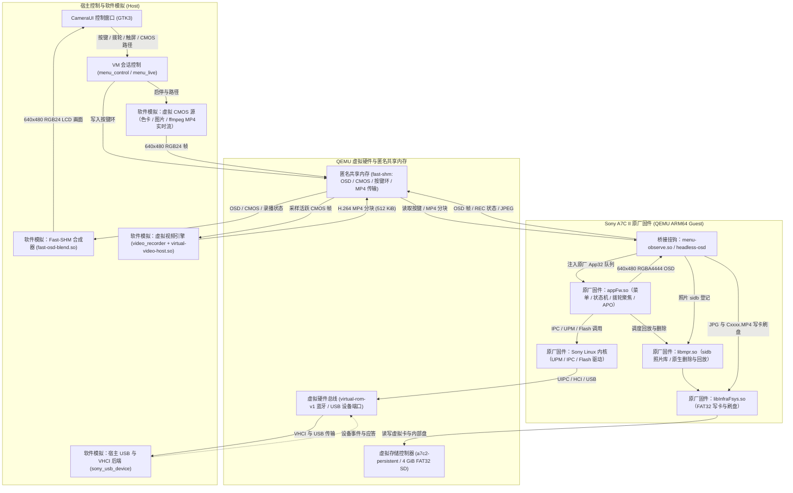

# A7C II QEMU 模拟器

在 Linux 电脑上运行 Sony A7C II（ILCE-7CM2）的原厂固件，用相机外观的窗口操作原厂界面、按键和拨盘，方便研究相机软件，无需连接真实相机。

默认窗口提供原厂界面、菜单、机身按键、4 个拨轮、默认虚拟 CMOS 色卡（支持本地图片与 `.mp4` 视频热替换）、底部曝光 HUD、静态照片拍摄与原厂单张播放/删除、软件 H.264 录像写卡（`PRIVATE/M4ROOT/CLIP/Cxxxx.MP4`）、省电自动唤醒、相机 USB 设备（「连接电脑」）以及虚拟存储，并可在底部可折叠“功能开关与固件开发”面板中按需开启或关闭。33 MP JPEG 与未压缩 RAW 写卡仍使用独立的实验配置。


上图为单窗口 Sony α7C II 仿真机身控制界面（上方为机顶工程线稿视图，集成 `ON/OFF` 电源拨杆、快门半按/全按、`REC`、模式拨盘、`照片/录像/S&Q` 切换杆、**前拨轮**与**右上拨轮**；下方为机背工程线稿视图，集成 4:3 实时 QEMU RAMFB / Fast-SHM 取景 LCD、`MENU`/`C1`/`AF-ON`/`Fn`、**后拨轮**、**控制轮**与播放/删除/`C2`；底部单行控制栏提供运行状态、虚拟存储、**连接电脑**（USB 设备）、**CMOS 色卡 / 选择图片/视频… / 恢复色卡**与重置设置，最底部可展开“功能开关与固件开发”面板）。取景合成、CMOS 帧流、镜头曝光、H.264 视频编码与播放解码均由软件虚拟模型提供，写入虚拟 SD 卡文件与设置存储则调用原厂固件接口落盘，不代表真实 CP ASIC 或物理 ISP。

**独立运行产品：外部只需自己的 `BODYDATA.DAT` 和 QEMU 11.1.2 源码归档。** 相机运行代码、虚拟设备、资源导入和构建入口均在本仓库；不需要 `a7c2-re`、系统 dump 或历史实验目录。

## 能做什么

- **运行原厂程序与冷启动**：从自己的 2.01 ALLLANG `BODYDATA.DAT` 导入相机程序和内核；所有启动参数统一由仓库根目录的 [`a7c2.env`](a7c2.env) 和环境变量控制。
- **原厂界面、Fn 菜单与底部曝光 HUD**：显示 640×480 相机 LCD，可完成简体中文首设、浏览主菜单和原厂 Fn 快捷菜单；拍摄页面底部通过虚拟镜头模型实时联动原厂快门、光圈与 ISO 显示。
- **自动省电（APO1）按任意键唤醒**：操作按键或拨盘时自动重置原厂内核 60 秒省电计时；静置触发自动省电黑屏后，按任意机身按键、拨盘或触屏即可经原厂内核 UPM 唤醒回到实时拍摄画面（可在 UI 开关）。
- **相机 USB 设备与 UI 功能开关**：默认启用相机 USB 设备端点（「连接电脑」），与 QEMU RAM 快照会话、省电自动唤醒、虚拟镜头 HUD/拍摄、内部持久磁盘等均可在界面中直接开关。
- **LCD 触屏**：在画面内用鼠标左键点击或拖动，也支持 GDK 单指触摸（不支持多指手势）。见[触屏用法](report/2026-11-11-touchscreen/README.md)。
- **低延迟机身按键与 4 个拨轮**：提供机身按键、模式拨盘与 4 个拨轮（前拨轮、后拨轮、控制轮、右上曝光补偿拨轮），A / S / M / P 档跟随原厂固件自身的拨轮映射与橙色聚焦；LCD 采用零 PNG 原始 RGB24 自适应刷新。见[输入和显示实现](docs/tech/2026-11-07-low-latency.md)。
- **虚拟 CMOS 色卡与本地图片 / 视频输入**：默认显示虚拟 CMOS 色卡，可在底部控制栏点击“选择图片/视频…”导入本地 PNG/JPEG 等图片，或选择 `.mp4` / `.m4v` / `.mov` 视频实时缩放/垫边为 640×480 循环播放作为实时 CMOS 画面源（可用于拍照与录像），或点击“恢复色卡”。
- **虚拟拍照写卡与原厂单张播放界面**：全按快门将当前色卡、自定义图片或视频当前帧编码为含 Sony `ILCE-7CM2` EXIF 的 JPEG，调用原厂 `libInfraFsys.so` 写入 `DCIM/100MSDCF/DSCnnnnn.JPG` 并登记入 `libmpr.so`（`sidb`）；按**播放**键进入原厂单张播放界面（`scr7102_0001_still`，全幅无 1:1 暗边，支持左右翻页、`DISP` 切换显示、原厂照片删除与返回拍摄；直方图与详细 EXIF 面板受 CP 缺失限制为空），关机导出的 `SD/card.img` 可在宿主直接提取照片。
- **软件虚拟视频录制写卡**：实景取景下按 **REC**，或切换至 **MOVIE / S&Q** 档按全按快门即可起停录像（窗口与取景画面左上角同步显示 `REC MM:SS` 计时）；停录或直接点击 **OFF** 关机时自动收尾，由宿主虚拟视频引擎（`libx264` + `libavformat`）编码为 640×480 H.264 `.MP4`，再传回 guest 经索尼原厂 `libInfraFsys.so` 写入虚拟卡 `PRIVATE/M4ROOT/CLIP/Cxxxx.MP4` 并执行 FNV-1a 读回校验与 FAT32 刷盘。导出的 `SD/card.img` 可在宿主机直接提取播放 `.MP4`；未写入原厂 `MEDIAPRO.XML` / 视频 `sidb`（机身**播放**键仅回放静态照片）。
- **虚拟 SD 卡与保留设置**：原冷启动默认创建 4 GiB FAT32 稀疏虚拟卡（同时兼容既有 1 GiB 存档卡镜像），支持安全拔出、重新插入与关机镜像导出；可跨启动保留语言和日期格式。
- **修改运行环境**：用 `overwrite/` 替换程序或库，或用“功能开关与固件开发”面板切换替代文件与原版，并从 guest 读回文件属性和摘要。

| 原厂 Fn 快捷菜单 | 自定义 CMOS + 曝光 HUD | 原厂单张播放界面 `scr7102_0001_still` |
| :---: | :---: | :---: |
|  |  |  |

## 系统架构与模块边界

真机 ILCE-7CM2 为 **AP（ARM64 Linux）+ CP（独立协处理器与 ISP / 编码 / 显示 ASIC）** 双芯片架构。QEMU 中完整运行 **Sony 原厂 ARM64 内核与应用程序**，缺失的物理 CP ASIC、光学 CMOS 与外设则由 **QEMU 虚拟硬件 + 宿主/Guest 软件模型** 协同模拟：



| 子系统 | 实现位置 | 归属性质 | 具体职责与边界 |
| --- | --- | --- | --- |
| 原厂系统与 UI | `vmlinux`、`init`/`init2`、`appFw.so`、`bsa_server` | **原厂固件运行** | 启动流程、全部菜单与取景 HUD 绘制、A/S/M/P 拨轮逻辑、APO 省电定时、蓝牙服务管理 |
| 媒体库与写卡 | `libmpr.so`（`sidb`）、`libInfraFsys.so` | **原厂固件运行** | 静态照片目录登记与原生删除、FAT32 目录创建、JPG / MP4 写入与卷刷盘（暂不写视频 `sidb` / `MEDIAPRO.XML`） |
| 虚拟存储与总线 | `a7c2-persistent`、`sd-window-export`、`virtual-hci`、`sony_usb_device` | **QEMU / 虚拟硬件模拟** | 19 卷内部持久盘、4 GiB FAT32 稀疏 SD 卡与导出、蓝牙控制器 ROM 应答、USB 设备端点 |
| 显示与 CMOS 输入 | `fast-shm`、`fast-osd-blend.so`、`cmos_source.py`、`headless-osd` | **软件虚拟模型** | 采集 AP 提交的 `RGBA4444` OSD、模拟 CMOS 色卡/图片/`ffmpeg` MP4 帧流、宿主零拷贝合成 LCD |
| 镜头 / 拍照 / 录像 | `virtual-lens-hud`、`virtual-cmos-capture`、`virtual-video-host.so` | **软件虚拟模型** | 响应原厂拨轮调整曝光显示、编码 640×480 照片 JPEG、在宿主用 `libx264` 编码 MP4 并传回 guest 调原厂 Fsys 写卡（不模拟物理 CP ASIC / ISP） |

## 虚拟 CMOS 与静态照片

实验配置 `functional-ram-card-independent-internal-v1` 使用[虚拟 CMOS](report/virtual-sensor/README.md)生成 GRBG Bayer 色卡，显示帧为 640×480，L 尺寸照片为 7008×4672。固件负责 JPEG 编码、ARW 封装和 Fsys 写卡。未压缩 RAW 在原厂菜单选择 `RAW-only`、`L` 和 `UNCOMPRESS`，输出到虚拟卡的 `DCIM/100MSDCF/`。


上图为虚拟卡中 `DSC00001.ARW` 经 LibRaw 解码后缩至 900×600 的预览。ARW 使用 `Compression=1`，以小端 16 位容器保存 14 位 GRBG 样本，行跨度为 14,016 字节。图中两条黑白横带是色卡的细节图案。

RAW 模式可以在宿主和 guest 之间使用无损 RLE 传送 RGB 帧，guest 还原完整像素后再交给原厂消费者。RLE 不改变 ARW 的未压缩格式，也不模拟相机内部总线。

[](docs/images/virtual-cmos-color-chart.png)

[完整 7008×4672 色卡](docs/images/virtual-cmos-color-chart.png)由宿主传感器模型直接生成，是输入场景示意，不是固件写卡成片。

RAW 写卡后的资源清理仍属于实验范围；RAW＋JPEG 与其他 RAW 压缩模式不在当前支持范围内。默认主窗口另提供基于软件虚拟视频引擎与原厂 `libInfraFsys` 的 640×480 MP4 录像写卡（不代表物理 CP ASIC 硬件编码，亦不支持机内回放录像）。

## 怎么运行

需要 Linux x86_64、Python 3.12+ 和 X11／Xwayland 桌面。建议准备 32 GiB 内存和至少 20–30 GiB 可用磁盘，使用普通用户运行，系统需允许 bubblewrap 使用用户命名空间。

先准备：

1. 自己的 **ILCE-7CM2 2.01 ALLLANG `BODYDATA.DAT`**（放到 `incoming/bodydata/BODYDATA.DAT`，或在 `a7c2.env` 中填写 `A7C2_BODYDATA`）。其它版本暂不支持，仓库不提供 Sony 固件。
2. [QEMU 11.1.2 源码归档](https://download.qemu.org/qemu-11.1.2.tar.xz)，放到 `source/vendor/qemu-11.1.2.tar.xz`。校验信息见[源码下载说明](source/vendor/README.md)。
3. Python 图形、加密依赖和编译工具。下面的检查脚本会列出缺少的命令、模块和开发库；Python 构建环境还需要 pip、setuptools 和 wheel。

在仓库目录执行：

```bash
./tools/check-host.sh
python3 tools/check-source.py
A7C2_BODYDATA=/path/to/BODYDATA.DAT A7C2_PREPARE_ONLY=1 ./start.sh
./build-qemu.sh
./build-qemu.sh --stage-only --sony-device --ram-state
./start.sh
```

把 `/path/to/BODYDATA.DAT` 换成自己的固件路径（放入 `incoming/bodydata/BODYDATA.DAT` 或写入 `a7c2.env` 后直接运行 `./start.sh` 即可）。脚本不会自动下载源码或安装依赖。

### 配置文件与环境变量（`a7c2.env`）

`./start.sh` 不接受命令行参数，启动时会自动读取仓库根目录的 [`a7c2.env`](a7c2.env)（也可用 `A7C2_ENV_FILE=/path/to/custom.env` 指定其他文件）。若在 shell 中显式传入同名变量（如 `A7C2_VERIFY_SHA=1 ./start.sh`），shell 环境变量优先于 `a7c2.env`。

常用配置项（均已带默认启用值，可直接编辑 `a7c2.env`）：

| 变量 | 默认值 | 说明 |
| --- | --- | --- |
| `A7C2_BODYDATA` | 留空（自动查找） | `BODYDATA.DAT` 文件或目录路径，留空自动查找 `incoming/bodydata/BODYDATA.DAT` |
| `A7C2_BOOT_PROFILE` | `original-init-cold` | `original-init-cold`（原冷启动）或 `direct-bootin`（兼容启动） |
| `A7C2_COLD_FLAG` | `force` | 虚拟 loader 对 p5 WBI2 标记的处理：`force` / `clear` / `strict` |
| `A7C2_VERIFY_SHA` | `0` | 启动前是否执行全量 SHA256 校验：`0`（快速启动）/ `1`（全量校验） |
| `A7C2_ENABLE_USB_DEVICE` | `1` | 默认启用相机 USB 设备端点（「连接电脑」），与 RAM 会话互斥，可在 UI 切换 |
| `A7C2_RAM_MODE` | `0` | 设为 `1` 时启动即启用 QEMU RAM 快照会话（自动关闭 USB 设备），亦可在 UI 切换 |
| `A7C2_AUTO_WAKE` | `1` | 自动省电（APO1）按任意键唤醒 + 操作自动重置 60 秒省电计时，可在 UI 切换 |
| `A7C2_VIRTUAL_LENS_HUD` | `1` | 虚拟镜头 HUD、拨盘参数联动与软件 CMOS 拍摄/原厂回放，可在 UI 切换 |
| `A7C2_VIRTUAL_HCI` | `virtual-rom-v1` | 虚拟蓝牙控制器（留空禁用，禁用后原蓝牙初始化可能报错） |
| `A7C2_SD_IMAGE` | 留空 | 指定已有虚拟 FAT SD 镜像路径（普通文件） |
| `A7C2_OVERWRITE_DIR` | 留空 | 指定自定义 guest 文件覆盖目录 |
| `A7C2_PREPARE_ONLY` | `0` | 设为 `1` 仅导入校验固件资产，不启动 UI/VM |

窗口出现后会自动启动（或按 **ON**），等待完成相机的语言、日期等首设提示。启动排障见[启动排障文档](docs/tech/README.md)。

默认启动已启用 `virtual-rom-v1` 虚拟蓝牙控制器，让原 BSA 完成管理初始化，见[默认启动修复记录](docs/tech/2026-11-08-default-startup.md)。它只模拟有限控制器行为，不提供真实无线或手机配对；仅排查蓝牙依赖时可设置 `A7C2_VIRTUAL_HCI= ./start.sh`。

## 原 init 冷启动

默认 `./start.sh` 和窗口 ON 使用原用户态冷启动：从官方包的原 RAM0 运行原 init，经过 p7 根挂载、pivot/chroot、原 init2，再启动原相机程序。原有兼容路线仍可通过环境变量选择：

```bash
A7C2_BOOT_PROFILE=direct-bootin ./start.sh
```

独立 CLI 实验入口保留。准备好上面的产品资产后执行：

```bash
python3 tools/run-original-cold.py --new-instance \
  --output runtime/diagnostics/my-original-cold --seconds 180
```

CLI 创建专属内部盘，输出目录必须不存在。窗口默认使用自己的持久内部盘。原 BootROM、loader、CP、WBI 和完整硬件上电仍未完成，详见[原冷启动复现](docs/tech/2026-11-09-original-cold-boot.md)与[窗口集成记录](docs/tech/2026-11-09-original-cold-window.md)。

## 虚拟卡和设置

新原 cold 默认卡为 **4 GiB（FAT32 稀疏镜像）**，同时兼容既有 1 GiB 卡镜像；使用非零种子时，不会把整卡额外装入 initrd。见[虚拟 SD 专题](docs/tech/2026-11-10-1g-sd.md)。

关机时按 **OFF** 或关闭窗口，等待保存完成。默认虚拟卡保存为：

```text
runtime/analysis/menu-runs/run-*/SD/card.img
```

下次继续使用某张卡时，可在 `a7c2.env` 中设置 `A7C2_SD_IMAGE`，或临时传入环境变量：

```bash
A7C2_SD_IMAGE=/path/to/previous-run/SD/card.img ./start.sh
```

原冷启动的相机设置保存在同一内部盘的 `/setting`，保存时另有 `runtime/analysis/camera-instances/default/` 的已校验快照。旧内存路线的快照只迁入内部盘一次；以后保留盘上实际值。完整设置持久化尚未验证。同一窗口内的重启自动沿用刚保存的虚拟卡。

运行中可以点击 **安全拔出 SD**，等窗口确认卡已拔出，再点击 **插入 SD**。目前只能重插同一张虚拟卡，还不能在运行中换选另一张镜像。

如果保存失败，窗口会保留运行实例与错误信息，并提示重试正常保存或在确认后强制关闭本窗口拥有的虚拟机。

## 内部持久磁盘、USB 与固件开发

展开窗口底部“功能开关与固件开发”折叠面板可直接管理**相机 USB 设备**、**省电自动唤醒**、**虚拟镜头 HUD / 拍摄**、**QEMU RAM 会话**与**内部持久磁盘**（停机状态勾选，下次开机生效），并进行文件测试、重启和 RAM 保存/恢复。

- **相机 USB 设备（默认开启）**：需先完成 `./build-qemu.sh --stage-only --sony-device --ram-state`（会自动发现最新构建）；运行中可点击底部控制栏 **连接电脑**。普通相机菜单中的 USB 启动和 MSC 仍属独立范围，详见 [USB 专题](docs/tech/2026-11-09-usb-jiritsu.md)。
- **QEMU RAM 会话**：在停机状态勾选 **QEMU RAM 会话**（会自动关闭 USB 设备）再按 **ON**，保存 RAM 并退出后可用同一内部盘恢复。见[窗口 RAM 模式](docs/tech/2026-11-09-window-ram.md)。RAM 恢复不是原厂 WBI；完整 BODYDATA 更新尚不支持。
- **内部持久磁盘**：原冷启动默认使用并保留内部持久磁盘；兼容路线可在停止 VM 后勾选“内部持久磁盘”，或设置 `A7C2_BOOT_PROFILE=direct-bootin A7C2_USE_PERSISTENT_STORAGE=1 ./start.sh`。

第一次会从自己的官方 BODYDATA 缓存创建单个内部磁盘文件，容量和 19 个卷的布局由官方分区表决定；用户区与两个 boot 区总计 1,962,934,272 字节。生成物保存在 `runtime/analysis/persistent-storage/`，已有实例不会在重启时重铺。只使用普通虚拟磁盘文件。

持久盘文件测试当前支持 `/usr` 下的程序或库：保存退出后选择文件和目标路径，ON 后点击读回检查；必须看到实际 guest 的完整摘要、长度与 root 字段匹配。选择“原版”后再次启动会把对应目标恢复为包内原文件。见[开发与存储说明](docs/tech/2026-11-08-development-and-storage.md)。

## 替换程序或库

将修改后的文件放进 `overwrite/`，按相机内的路径排列。例如替换 `/usr/lib/appFw.so`：

```text
overwrite/
└── usr/
    └── lib/
        └── appFw.so
```

正常执行 `./start.sh` 就会加载这些文件。也可以在 `a7c2.env` 中设置 `A7C2_OVERWRITE_DIR` 或临时传入：

```bash
A7C2_OVERWRITE_DIR=/path/to/my-overwrite ./start.sh
```

覆盖目录只接受普通文件和目录，不支持符号链接。原冷启动只接受包内已有、可恢复的 `/usr` 文件；修改写入当前虚拟内部盘，原始固件文件保持只读。恢复原版时，在停止后使用开发面板的“原版”再启动并读回；仅移走覆盖文件不会撤销已持久化的改动。兼容路线的非持久模式仍仅修改派生启动镜像。

替换不兼容的程序或库可能导致启动失败。

## 技术文档

- [开发面板与单盘集成](docs/tech/2026-11-08-development-and-storage.md)：文件替换、启动与存储实现。
- [原 init 冷启动](docs/tech/2026-11-09-original-cold-boot.md)：从原 RAM0 经 `init`、根挂载和 `init2` 到相机应用的启动路径。
- [图像源与显示配置](docs/tech/functional-source-and-display.md)：软件成像、显示与实验配置。
- [低延迟输入、拨轮、虚拟 CMOS 与原厂播放实机报告](report/2026-11-22-ui-latency-dials-fn-cmos-capture/README.md)：相关实现细节、问题排查与实机验证收据。
- [环境配置、默认功能与 APO1 唤醒实机报告](report/2026-11-22-env-config-default-features-apo-wake/README.md)：`a7c2.env` 纯环境配置、UI 功能开关与省电唤醒验证记录。
- [MP4 虚拟 CMOS 输入与视频录制写卡报告](report/2026-11-23-mp4-cmos-and-movie-record/README.md)：本地 `.mp4` 实时 CMOS 推流、宿主 `libx264` 录像与原厂 `libInfraFsys` SD 写卡实现、实机验收与模块边界说明。
- [启动排障与技术笔记](docs/tech/README.md)：固件导入、显示、输入、存储和成像。
- [验证记录](validation/README.md)与[源码来源](SOURCES.md)、[第三方许可](THIRD-PARTY.md)。

固件、私有设置、虚拟卡和运行时生成的二进制均不随源码分发。
