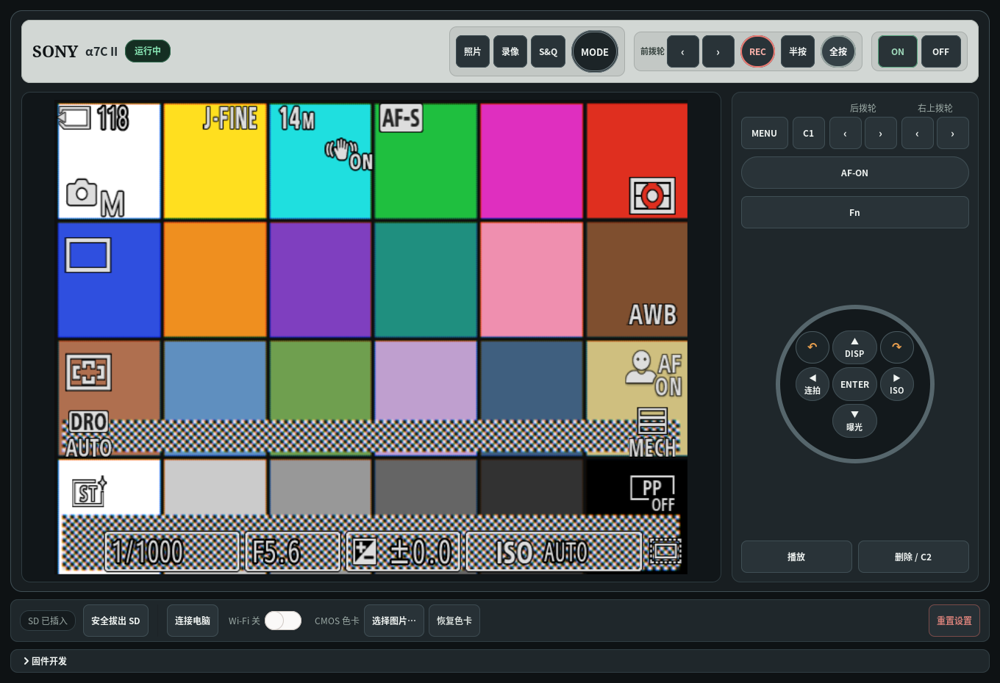

# A7C II QEMU 模拟器

在 Linux 电脑上运行 Sony A7C II（ILCE-7CM2）的原厂固件，用相机外观的窗口操作原厂界面、按键和拨盘，方便研究相机软件，无需连接真实相机。

默认窗口提供原厂界面、菜单、机身按键、4 个拨轮、默认虚拟 CMOS 色卡（支持页面选择本地图片热替换）、底部曝光 HUD、全按快门虚拟拍摄写卡与播放页浏览，以及虚拟存储。33 MP JPEG 与未压缩 RAW 写卡仍使用独立的实验配置。



上图为当前单窗口相机界面（LCD 画面为隔离实机冷启动的真实 [QEMU RAMFB 帧](docs/images/live-dial-m-hud-20261122.png)），工具栏新增 **CMOS 色卡 / 选择图片… / 恢复色卡**，底部移除冗余的“快捷键与日志”抽屉，仅保留折叠的“固件开发”面板。默认色卡由冷启动脚本写入 `functional-cmos-chart-v1` 开启，在原厂 HUD 透明层后合成；它属于软件虚拟 CMOS 模型，不代表真实 CP 的 YC 视频通路或物理 ISP。

**独立运行产品：外部只需自己的 `BODYDATA.DAT` 和 QEMU 11.1.2 源码归档。** 相机运行代码、虚拟设备、资源导入和构建入口均在本仓库；不需要 `a7c2-re`、系统 dump 或历史实验目录。

## 能做什么

- **运行原厂程序与快速冷启动**：从自己的 2.01 ALLLANG `BODYDATA.DAT` 导入相机程序和内核，支持 `--cold-flag`（默认 `force`）与 `--no-verify-sha`（默认跳过启动全量 SHA 复算），配合 TCG `tb-size=2048` 实机约 11 秒到达首帧。
- **查看原厂界面与底部曝光 HUD**：显示相机 LCD，可用简体中文完成首设、浏览主菜单和原厂 Fn 快捷菜单；拍摄主页下方通过虚拟镜头模型经原 OSAL 队列向原厂 HUD 实时显示快门、光圈与 ISO。
- **LCD 触屏**：在画面内用鼠标左键点击或拖动，也支持 GDK 单指触摸。不支持多指手势。见[触屏用法](report/2026-11-11-touchscreen/README.md)。
- **低延迟机身按键与 4 拨轮**：窗口提供主要按键和 4 个拨轮（前拨轮 ±22、后拨轮 ±30、控制轮 ±24、右上拨轮 ±1024）。LCD 通道直传 640×480 原始 RGB24（去掉同进程 PNG 编解码），空闲 15 Hz / 按键立即唤醒 60 Hz；Fn 键在 guest 内原子点按（20 ms）以避开固件 500 ms 长按分支。见[输入和显示实现](docs/tech/2026-11-07-low-latency.md)。
- **默认 CMOS 色卡 + 自定义图片热替换**：默认启用色卡背景，可在工具栏点击“选择图片…”导入本地 PNG/JPEG 等图片（宿主等比缩放到 640×480 后经串口分块送入 guest `cmos-import` 原子替换），随时可点“恢复色卡”。
- **全按快门写虚拟 SD + 原厂播放界面**：拍摄画面全按快门将当前色卡或自定义图片编码为 Baseline JPEG（含 Sony `ILCE-7CM2` EXIF 2.32），经原 `libInfraFsys.so` 写入虚拟 SD 卡 `DCIM/100MSDCF/DSCnnnnn.JPG` 并读回校验，同时经原 `libmpr.so` `sidb` 登记入图像索引；按**播放**键直接进入索尼原厂单张播放界面（`scr7102_0001_still`，支持 `LEFT`/`RIGHT` 翻页、`UP`/`DISP` 切换 `scr7102_0003_still` / `scr7102_0002_still`、再按播放键返回拍摄），由 `ramfb-viewer` 将真实 JPEG 软解码画面与原厂透明播放 OSD 合成显示；关机导出的 `SD/card.img` 可在宿主直接解出照片。
- **使用虚拟 SD 卡与保留设置**：原冷启动默认创建 1 GiB FAT16 虚拟卡，支持安全拔出、重新插入与关机镜像导出；可跨启动保留语言和日期格式。
- **修改运行环境**：用 `overwrite/` 替换程序或库，或用“固件开发”面板切换替代文件与原版，并从 guest 读回文件属性和摘要。

## 近期更新与实机验证（2026-11-22）

以下全部项目已在**独立隔离的冷启动 QEMU 实例**中配合真实 ILCE-7CM2 2.01 固件完成端到端实机验证（不干扰宿主已有实例）。软件虚拟 CMOS / 虚拟镜头 / 软件 JPEG 解码不代表真实 CP ASIC 或物理 ISP，原厂硬件指标 `capture_verified` 仍保持 `false`。

| 项目 | 实现内容 | 实机验证结果 |
| --- | --- | --- |
| 按键与显示延迟 | `ContinuousLCD` 自适应 15/60 Hz + 按键即刻唤醒 + 零 PNG 原始 RGB24（921,600 B）直出到 `GdkPixbuf`；GTK 定时器降为 100 ms 并缓存 26 个按钮状态；移除底部“快捷键与日志”抽屉；`console.log` seek 增量读；guest `ramfb-viewer` RAM 缓存合成 + `inotify`；冷启动默认 `tb-size=2048` 且关闭 `-d` 跟踪 | 实机冷启动 **11.21–13.92 s**，原始 RGB24 零 PNG 生效；菜单开/关延迟 **624.6 ms / 827.9 ms**，Fn 打开延迟 **652.0 ms** |
| Fn 键 | GTK 按钮点击与键盘 `F` 均走 guest `inject-key --serve-app` 原子 `TAP`（20 ms hold），避免 guest 虚拟时钟快于宿主而落入 ≥500 ms 长按分支 | 实机打开原厂 Fn 快捷菜单（`CREATE_SCREEN id=0xc2` / `scr0135_0001`）并可正常退出 |
| 4 个拨轮 + 原厂聚焦一致 | 对调后拨轮（`0x10000016` / `2ea`）与右上拨轮（`0x10000013` / `2ef`）并修正单步；`menu-observe.so` 直接挂载 `appFw.so` 原厂 7 个拨轮叶子执行函数（光圈 / 快门 / 程序偏移 / ISO），完全跟随固件自身的挡位映射与橙色聚焦，不再私自猜测前后拨轮 | 实机验证 **A 档**前/后拨轮均调光圈并橙色聚焦 `F5.6`–`F6.3`；**S 档**前/后拨轮均调快门并橙色聚焦 `1/500`–`1/2000`；**M 档**前拨轮调光圈（`F8.0`）、后拨轮调快门（`1/4000` 橙色聚焦）；**P 档**前后拨轮触发程序偏移；右上拨轮调出橙色曝光补偿 `+0.7` |
| 默认色卡 + 自定义 CMOS | `bootin.sh` 默认写入 `functional-cmos-chart-v1`；工具栏“选择图片…/恢复色卡”经 `cmos_source.py` + guest `cmos-import` 热替换 `/tmp/virtual-cmos-custom.rgb` | 实机默认即显示色卡；自定义测试图上传热替换生效，“恢复色卡”实时还原 |
| 全按写卡 + 原厂播放界面 | `menu-observe.so` 绑定原厂 `libInfraFsys.so` 与 `libmpr.so` `sidb`，全按写 `DCIM/100MSDCF/DSCnnnnn.JPG`（含 EXIF 2.32 日期时间）并登记图像库；拦截被 CP Lane 0 阻塞的 `sequence_playback`（`0x30`）改由单常驻工作线程运行原厂 `sidb::Select` + `start_playback_exit`，由软件解码 JPEG 至 `/tmp/virtual-playback-bg.bin` 并经 `ramfb-viewer` 合成原厂透明播放 OSD | 实机连拍色卡 `DSC00001.JPG`（58,241 B）与自定义图 `DSC00002.JPG`（14,358 B）均 `rc=0 readback=1` 且 `sidb` 登记成功；按播放进入真原厂 `scr7102_0001_still`（`id=0x23`，70 控件，显示 `2/2` / `1/2`、`100-0001`、`3:2`、`22-11-2026 12:00:00`），`LEFT`/`RIGHT` 翻页、`UP`/`DISP` 切换 `scr7102_0003_still` / `scr7102_0002_still` 与返回拍摄全部实机验证通过（直方图/详细 EXIF 数据仍受 CP 缺失限制为空） |
| OFF 关机与窗口关闭 | 移除 `menu-observe.so` 中的事件就地改写与高频 `pthread_create`，收敛为单常驻 pipe 唤醒工作线程；修复 `original-init-cold` 启动期关闭通道误关导致的挂死；窗口关闭在非运行态跳过输入释放，优雅关机失败时弹出明确确认的“重试正常保存 / 强制关闭”对话框且仅在核验子进程组退出后释放租约 | 实机连续多次验证 `OFF`（`EXPORT_SD + SHUTDOWN_STORAGE`）在 **2.43 s** 内完成：`ok=True`、`settings_ok=True`、`internal_frozen=True`、`qmp_quit_confirmed=True`、`returncode=0`、`signals_sent=[]` |

| 原厂 Fn 快捷菜单（实机） | 自定义 CMOS + 拨轮 M 档 HUD（实机） | 索尼原厂单张播放界面 `scr7102_0001_still`（实机） |
| :---: | :---: | :---: |
|  |  |  |

## 虚拟 CMOS 与静态照片

实验配置 `functional-ram-card-independent-internal-v1` 使用[虚拟 CMOS](report/virtual-sensor/README.md)生成 GRBG Bayer 色卡，显示帧为 640×480，L 尺寸照片为 7008×4672。固件负责 JPEG 编码、ARW 封装和 Fsys 写卡。未压缩 RAW 在原厂菜单选择 `RAW-only`、`L` 和 `UNCOMPRESS`，输出到虚拟卡的 `DCIM/100MSDCF/`。


上图为虚拟卡中 `DSC00001.ARW` 经 LibRaw 解码后缩至 900×600 的预览。ARW 使用 `Compression=1`，以小端 16 位容器保存 14 位 GRBG 样本，行跨度为 14,016 字节。图中两条黑白横带是色卡的细节图案。

RAW 模式可以在宿主和 guest 之间使用无损 RLE 传送 RGB 帧，guest 还原完整像素后再交给原厂消费者。RLE 不改变 ARW 的未压缩格式，也不模拟相机内部总线。

[](docs/images/virtual-cmos-color-chart.png)

[完整 7008×4672 色卡](docs/images/virtual-cmos-color-chart.png)由宿主传感器模型直接生成，是输入场景示意，不是固件写卡成片。

RAW 写卡后的资源清理仍属于实验范围。RAW＋JPEG、其他 RAW 压缩模式和录像写卡不在当前支持范围内。

## 怎么运行

需要 Linux x86_64、Python 3.12+ 和 X11／Xwayland 桌面。建议准备 32 GiB 内存和至少 20–30 GiB 可用磁盘，使用普通用户运行，系统需允许 bubblewrap 使用用户命名空间。

先准备：

1. 自己的 **ILCE-7CM2 2.01 ALLLANG `BODYDATA.DAT`**。其它版本暂不支持，仓库不提供 Sony 固件。
2. [QEMU 11.1.2 源码归档](https://download.qemu.org/qemu-11.1.2.tar.xz)，放到 `source/vendor/qemu-11.1.2.tar.xz`。校验信息见[源码下载说明](source/vendor/README.md)。
3. Python 图形、加密依赖和编译工具。下面的检查脚本会列出缺少的命令、模块和开发库；Python 构建环境还需要 pip、setuptools 和 wheel。

在仓库目录执行：

```bash
./tools/check-host.sh
python3 tools/check-source.py
./start.sh --bodydata /path/to/BODYDATA.DAT --prepare-only
./build-qemu.sh
./start.sh --bodydata /path/to/BODYDATA.DAT
```

把 `/path/to/BODYDATA.DAT` 换成自己的固件路径。脚本不会自动下载源码或安装依赖。

启动选项速查：

- `--cold-flag force|clear|strict`（或 `A7C2_COLD_FLAG`，默认 `force`）：控制虚拟 loader 对 p5 WBI2 标记的处理策略。
- `--verify-sha` / `--no-verify-sha`（或 `A7C2_VERIFY_SHA=1|0`，默认 `0`）：是否在每次启动前执行全量文件 SHA 校验；日常开发默认关闭以加快启动。

窗口出现后按 **ON**，等待启动并完成相机的语言、日期等提示。启动失败、停在教程或显示“系统出错”时，可以先查看[启动排障文档](docs/tech/README.md)。

默认相机启动现在选择已有的 `virtual-rom-v1` 虚拟蓝牙控制器，让原 BSA 完成管理初始化，无需额外设置环境变量，见[默认启动修复记录](docs/tech/2026-11-08-default-startup.md)。它只模拟有限控制器行为，不提供真实无线或手机配对。原系统错误页没有被屏蔽；后续黑帧与完整唤醒仍待修复。

仅在排查原蓝牙依赖时，可以显式禁用该模型作对照：

```bash
A7C2_VIRTUAL_HCI= ./start.sh --bodydata /path/to/BODYDATA.DAT
```

禁用后原蓝牙初始化可能失败并显示“系统出错”；原配置不会因选择这个对照而重置。

第一次导入和编译完成后，后续只需：

```bash
./start.sh --bodydata /path/to/BODYDATA.DAT
```

也可以把固件放到 `incoming/bodydata/BODYDATA.DAT`，以后直接执行 `./start.sh`。

## 原 init 冷启动

默认 `./start.sh` 和窗口 ON 使用原用户态冷启动：从官方包的原 RAM0 运行原 init，经过 p7 根挂载、pivot/chroot、原 init2，再启动原相机程序。原有兼容路线仍可显式选择：

```bash
./start.sh --boot-profile direct-bootin
```

独立 CLI 实验入口保留。准备好上面的产品资产后执行：

```bash
python3 tools/run-original-cold.py --new-instance \
  --output runtime/diagnostics/my-original-cold --seconds 180
```

CLI 创建专属内部盘，输出目录必须不存在。窗口默认使用自己的持久内部盘。原 BootROM、loader、CP、WBI 和完整硬件上电仍未完成，详见[原冷启动复现](docs/tech/2026-11-09-original-cold-boot.md)与[窗口集成记录](docs/tech/2026-11-09-original-cold-window.md)。

## 虚拟卡和设置

新原 cold 默认卡为 **1 GiB**；使用非零种子时，不会把整卡额外装入 initrd。见[虚拟 SD 专题](docs/tech/2026-11-10-1g-sd.md)。

关机时按 **OFF** 或关闭窗口，等待保存完成。默认虚拟卡保存为：

```text
runtime/analysis/menu-runs/run-*/SD/card.img
```

下次继续使用某张卡时，指定它的路径：

```bash
./start.sh --bodydata /path/to/BODYDATA.DAT \
  --sd-image /path/to/previous-run/SD/card.img
```

原冷启动的相机设置保存在同一内部盘的 `/setting`，保存时另有 `runtime/analysis/camera-instances/default/` 的已校验快照。旧内存路线的快照只迁入内部盘一次；以后保留盘上实际值。完整设置持久化尚未验证。虚拟卡需要通过 `--sd-image` 手动选择；同一窗口内的重启自动沿用刚保存的卡。

运行中可以点击 **安全拔出 SD**，等窗口确认卡已拔出，再点击 **插入 SD**。目前只能重插同一张虚拟卡，还不能在运行中换选另一张镜像。

如果保存失败，窗口会保留运行实例和错误信息。请先处理错误，再关闭相关进程，避免丢失尚未保存的数据。

## 内部持久磁盘与固件开发

窗口的“固件开发”面板提供文件测试、启动测试和更新三个区域。要保留会话，可在停机状态选择 RAM 模式，再按 **ON**。保存 RAM 并退出后，可用同一内部盘恢复。见[窗口 RAM 模式](docs/tech/2026-11-09-window-ram.md)。RAM 恢复不是原厂 WBI；完整 BODYDATA 更新尚不支持。

原冷启动默认使用并保留内部持久磁盘。兼容路线可以在停止 VM 后勾选“使用内部持久磁盘”，或者执行：

```bash
./start.sh --boot-profile direct-bootin --persistent-storage
```

第一次会从自己的官方 BODYDATA 缓存创建单个内部磁盘文件，容量和19个卷的布局由官方分区表决定；用户区与两个 boot 区总计 1,962,934,272 字节。生成物保存在 `runtime/analysis/persistent-storage/`，已有实例不会在重启时重铺。只使用普通虚拟磁盘文件。

持久盘文件测试当前支持 `/usr` 下的程序或库：保存退出后选择文件和目标路径，ON 后点击读回检查；必须看到实际 guest 的完整摘要、长度与 root 字段匹配。选择“原版”后再次启动会把对应目标恢复为包内原文件。见[开发与存储说明](docs/tech/2026-11-08-development-and-storage.md)。完整设置持久化尚不支持。

显式 USB 配置可在本机枚举 Sony USB 设备并通过 jiritsu 访问 guest。普通相机菜单中的 USB 启动和 MSC 尚未接通；配置与限制见 [USB 专题](docs/tech/2026-11-09-usb-jiritsu.md)。

## 替换程序或库

将修改后的文件放进 `overwrite/`，按相机内的路径排列。例如替换 `/usr/lib/appFw.so`：

```text
overwrite/
└── usr/
    └── lib/
        └── appFw.so
```

正常执行 `./start.sh` 就会加载这些文件。也可以指定另一个覆盖目录：

```bash
./start.sh --bodydata /path/to/BODYDATA.DAT \
  --overwrite-dir /path/to/my-overwrite
```

覆盖目录只接受普通文件和目录，不支持符号链接。原冷启动只接受包内已有、可恢复的 `/usr` 文件；修改写入当前虚拟内部盘，原始固件文件保持只读。恢复原版时，在停止后使用开发面板的“原版”再启动并读回；仅移走覆盖文件不会撤销已持久化的改动。兼容路线的非持久模式仍仅修改派生启动镜像。

替换不兼容的程序或库可能导致启动失败。

## 技术文档

- [开发面板与单盘集成](docs/tech/2026-11-08-development-and-storage.md)：文件替换、启动与存储实现。
- [原 init 冷启动](docs/tech/2026-11-09-original-cold-boot.md)：从原 RAM0 经 `init`、根挂载和 `init2` 到相机应用的启动路径。
- [图像源与显示配置](docs/tech/functional-source-and-display.md)：软件成像、显示与实验配置。
- [启动排障与技术笔记](docs/tech/README.md)：固件导入、显示、输入、存储和成像。
- [验证记录](validation/README.md)与[源码来源](SOURCES.md)、[第三方许可](THIRD-PARTY.md)。

固件、私有设置、虚拟卡和运行时生成的二进制均不随源码分发。
