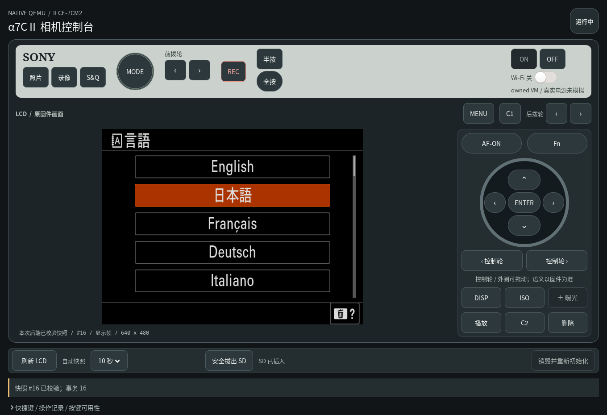

# A7C II QEMU 模拟器

在 Linux 电脑上运行 Sony A7C II（ILCE-7CM2）的原厂固件，用相机外观的窗口操作原厂界面、按键和拨盘，方便研究相机软件，无需连接真实相机。

**目前能操作菜单，还不能拍照或录像。取景区域仍是黑色，首次启动也可能停在设置、教程或错误页面。**



上图是程序实际启动后的窗口，屏幕里显示的是原厂固件的语言选择界面。

**11月7日源码更新：同步当前原生运行模型，并新增完整系统的持久盘、开发 UI、USB 与 P1 U/D/E 源码路线。** v35 原初始化返回0，后继在原 decryptor 加和校验39447≠60944处拒绝，安装仍未通过；本轮失败盘保全和精确恢复已完成。详见[最新进展](docs/tech/2026-11-07-current-progress.md)与[完整系统源码入口](report/2026-10-17-qemu-full-system/README.md)。

## 能做什么

- **运行原厂程序**：从自己的 2.01 ALLLANG `BODYDATA.DAT` 导入相机程序和内核。
- **查看原厂界面**：显示相机的 LCD 画面，可以选择简体中文、浏览菜单。拍摄主界面已有短时运行验证，完整启动和长期稳定性仍在完善。
- **操作机身控制**：窗口提供主要按键、拨盘和触摸操作。菜单操作可用，拍摄相关功能还没有全部接通。
- **使用虚拟 SD 卡**：原厂程序可以写入相机数据库等文件，支持安全拔出、重新插入，以及正常关闭后的卡镜像保存。
- **保留部分设置**：语言和日期格式已验证可以跨次启动恢复。全部设置、首次设置完成状态还没有完整保存，重新启动时可能再次出现首设。
- **修改运行环境**：可以用 `overwrite/` 替换本次运行使用的程序或库，测试自己的修改。

虚拟感光元件、软件镜头、对焦和 JPEG／H.264 编码已经有实现，也完成了组件测试。当前正在把这些设备接入原厂程序的拍摄流程，让它真正取得图像、编码并写入虚拟卡。**现在还没有由原厂程序拍下并保存的 JPG 或 MP4。**

## 怎么运行

需要 Linux x86_64、Python 3.12+ 和 X11／Xwayland 桌面。建议准备 32 GiB 内存和至少 20–30 GiB 可用磁盘，使用普通用户运行，系统需允许 bubblewrap 使用用户命名空间。

先准备：

1. 自己的 **ILCE-7CM2 2.01 ALLLANG `BODYDATA.DAT`**。其它版本暂不支持，仓库不提供 Sony 固件。
2. [QEMU 11.1.2 源码归档](https://download.qemu.org/qemu-11.1.2.tar.xz)，放到 `source/vendor/qemu-11.1.2.tar.xz`。校验信息见[源码下载说明](source/vendor/README.md)。
3. Python 图形、加密依赖和编译工具。下面的检查脚本会列出缺少的命令、模块和开发库；Python 构建环境还需要 pip、setuptools 和 wheel。

在仓库目录执行：

```bash
./tools/check-host.sh
python3 tools/check-source.py
./start.sh --bodydata /path/to/BODYDATA.DAT --prepare-only
./build-qemu.sh
./start.sh --bodydata /path/to/BODYDATA.DAT
```

把 `/path/to/BODYDATA.DAT` 换成自己的固件路径。脚本不会自动下载源码或安装依赖。

窗口出现后按 **ON**，等待启动并完成相机的语言、日期等提示。启动失败、停在教程或显示“系统出错”时，可以先查看[启动排障文档](docs/tech/README.md)。

第一次导入和编译完成后，后续只需：

```bash
./start.sh --bodydata /path/to/BODYDATA.DAT
```

也可以把固件放到 `incoming/bodydata/BODYDATA.DAT`，以后直接执行 `./start.sh`。

## 虚拟卡和设置

关机时按 **OFF** 或关闭窗口，等待保存完成。默认虚拟卡保存为：

```text
runtime/analysis/menu-runs/run-*/SD/card.img
```

下次继续使用某张卡时，指定它的路径：

```bash
./start.sh --bodydata /path/to/BODYDATA.DAT \
  --sd-image /path/to/previous-run/SD/card.img
```

相机设置默认保存在 `runtime/analysis/camera-instances/default/`，下次自动恢复。虚拟卡需要通过 `--sd-image` 手动选择。

运行中可以点击 **安全拔出 SD**，等窗口确认卡已拔出，再点击 **插入 SD**。目前只能重插同一张虚拟卡，还不能在运行中换选另一张镜像。

如果保存失败，窗口会保留运行实例和错误信息。请先处理错误，再关闭相关进程，避免丢失尚未保存的数据。

## 替换程序或库

将修改后的文件放进 `overwrite/`，按相机内的路径排列。例如替换 `/usr/lib/appFw.so`：

```text
overwrite/
└── usr/
    └── lib/
        └── appFw.so
```

正常执行 `./start.sh` 就会加载这些文件。也可以指定另一个覆盖目录：

```bash
./start.sh --bodydata /path/to/BODYDATA.DAT \
  --overwrite-dir /path/to/my-overwrite
```

覆盖目录只接受普通文件和目录，不支持符号链接。修改只影响本次生成的启动镜像，原始固件文件保持不变。恢复原版时，移走覆盖文件，并在下次启动时不再指定自定义目录；默认 `overwrite/` 也应保持为空或不存在。

替换不兼容的程序或库可能导致启动失败。

## 接下来做什么

优先目标是**让原厂程序拍出第一张能正常打开的 JPG，并保存到虚拟 SD 卡**。

当前原生源码已包含 OP20／21／22／23、保留帧输入/编码输出、BB timecode 与相应证据/退出检查；完整系统源码另在独立目录维护持久盘、恢复、开发 UI 和 P1 更新。研究环境已越过 v34 的 DEV 身份冲突，v35 原 receiver 随后因具体块和校验拒绝返回1。下一步闭合同一块的前后缀生产来源；完整 BODYDATA 读完、原 writer、安装、USB 认证与原媒体成片仍未证明。本次公开包实际 host 验证与研究原 guest 结果分别记录，见[11月7日进展](docs/tech/2026-11-07-current-progress.md)。

拍照打通后，继续推进：

- **实时取景**：让原厂界面显示虚拟场景。
- **镜头和拍摄参数**：让原厂程序实际控制软件镜头、对焦、曝光等设置。
- **录像**：接通录制开始、停止、编码和文件收尾，保存能正常播放的 MP4。
- **日常操作**：补齐剩余按键、拨盘、声音和设置保存，检查长时间运行和反复开关机。

## 研究文档

- [11月7日源码与进展](docs/tech/2026-11-07-current-progress.md)：当前原生/完整系统源码、v35闭合失败与精确恢复、公开host验证边界。
- [完整系统源码路线](report/2026-10-17-qemu-full-system/README.md)：持久盘、开发UI、USB与P1构建/执行入口及显式外部输入。
- [11月6日历史进展](docs/tech/2026-11-06-current-progress.md)：当时完整离线验收与4000／4057／4072失败；当次仅文档发布。
- [11月4日研究进展](docs/tech/2026-11-04-current-progress.md)：原输入与13图的验收、403e／VDF剩余阻塞；上次文档发布。
- [10 月 31 日历史进展](docs/tech/2026-10-31-current-progress.md)：上次源码移交时的原界面、数据消费和验证边界。
- [图像源与显示配置](docs/tech/functional-source-and-display.md)：公开代码、软件策略和拍摄边界。
- [开发进度与验证记录](validation/README.md)：已验证的功能、失败记录和仍未完成的部分。
- [启动排障与技术笔记](docs/tech/README.md)：固件导入、启动、显示、输入、存储和成像的定位方法，也可供其它机型迁移参考。
- [源码来源](SOURCES.md)与[第三方许可](THIRD-PARTY.md)。

固件、私有设置、虚拟卡和运行时生成的二进制均不随源码分发。
