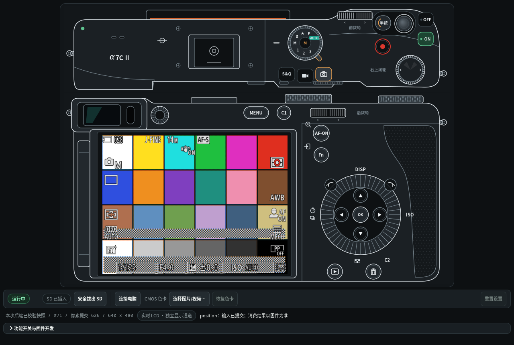
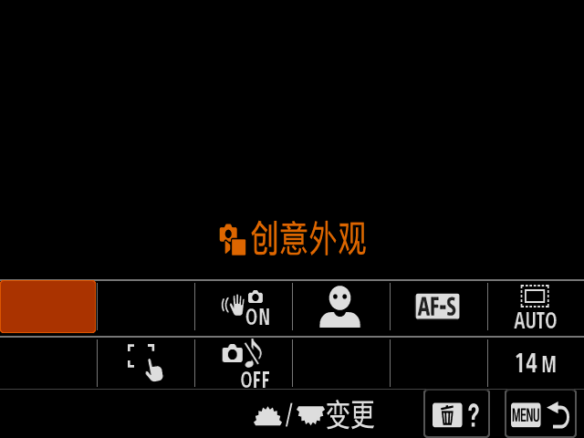
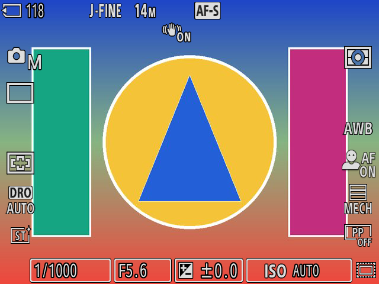
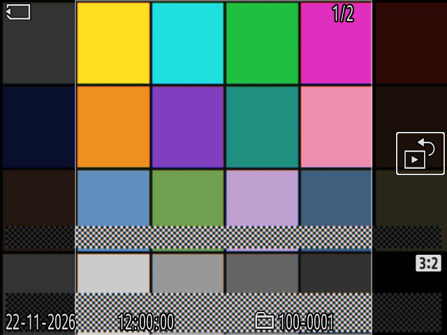
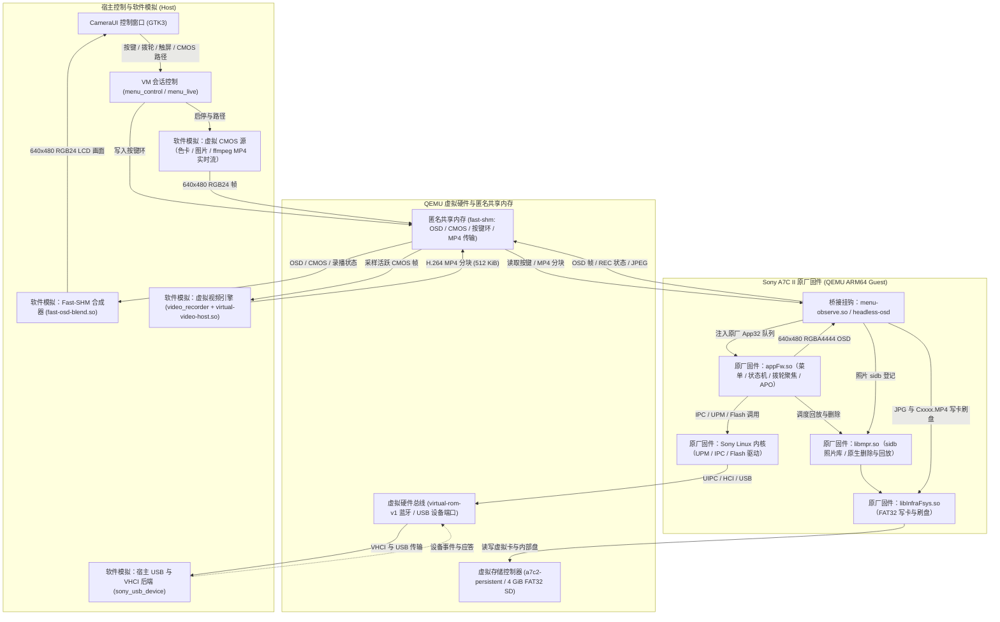

# A7C II QEMU 模拟器

在 Linux 电脑上运行 Sony A7C II（ILCE-7CM2）原厂固件，通过相机外观的窗口操作界面、按键和拨盘，无需连接真实相机。

外部只需自己的 **2.01 ALLLANG `BODYDATA.DAT`** 和 **QEMU 11.1.2 源码归档**；运行代码、虚拟设备、资源导入和构建入口均在本仓库，不依赖其他研究仓库或系统 dump。



窗口集成机顶与机背按键、4 个拨轮和 640×480 LCD；底部提供虚拟存储、USB 连接、CMOS 画面源和“功能开关与固件开发”面板。

## 能做什么

- **原厂界面与机身操作**：支持简体中文首设、主菜单、Fn 菜单、4 个拨轮及 A / S / M / P 档曝光联动；LCD 支持鼠标点击、拖动和 GDK 单指触摸，不支持多指手势。
- **虚拟 CMOS 输入**：默认显示色卡，可通过“选择图片/视频…”加载 PNG/JPEG 等图片或 `.mp4` / `.m4v` / `.mov` 视频，缩放、垫边为 640×480；视频循环播放，当前帧可用于拍照和录像。
- **拍照与原厂播放**：全按快门生成带 Sony EXIF 的 JPEG，写入 `DCIM/100MSDCF/DSCnnnnn.JPG`；按**播放**进入原厂单张播放界面，支持翻页、`DISP`、删除和返回拍摄。直方图与详细 EXIF 面板暂为空。
- **软件录像**：按 **REC**，或在 **MOVIE / S&Q** 档全按快门起停录像，界面显示 `REC MM:SS`；停录或 **OFF** 时收尾，生成 640×480 H.264 视频，写入 `PRIVATE/M4ROOT/CLIP/Cxxxx.MP4`。未写入视频 `sidb` / `MEDIAPRO.XML`，录像需从导出的虚拟卡提取播放，暂不支持机内回放。
- **虚拟存储与设置**：默认创建 4 GiB FAT32 稀疏 SD 卡，支持安全拔插、关机导出及部分设置跨启动保留。
- **省电唤醒与功能开关**：操作时重置 60 秒省电计时，黑屏后按键、拨盘或触屏可唤醒；USB、RAM 快照会话、自动唤醒和镜头 HUD 等可在开发面板切换。
- **固件开发**：通过 `overwrite/` 或开发面板替换程序和库，切回原版，并从 guest 读回属性与摘要。

取景、镜头曝光和视频编解码使用软件模型，媒体写卡调用原厂固件接口；不代表物理 CP ASIC / ISP。**33 MP JPEG 与未压缩 RAW 仍使用独立实验配置**，见下文。

| 原厂 Fn 快捷菜单 | 自定义 CMOS + 曝光 HUD | 原厂单张播放界面 `scr7102_0001_still` |
| :---: | :---: | :---: |
|  |  |  |

## 系统架构与模块边界

真机采用 **AP（ARM64 Linux）+ CP（协处理器与 ISP / 编码 / 显示 ASIC）** 双芯片架构。模拟器运行 Sony 原厂 ARM64 内核与应用，以 QEMU 虚拟硬件和宿主/guest 软件模型补足 CP、CMOS 与外设：



| 子系统 | 实现 | 职责 |
| --- | --- | --- |
| 原厂系统与 UI | `vmlinux`、`init`/`init2`、`appFw.so`、`bsa_server` | 启动、菜单与 HUD、拨轮逻辑、省电和蓝牙服务 |
| 原厂媒体库与写卡 | `libmpr.so`、`libInfraFsys.so` | 照片登记、播放和删除，JPG / MP4 写卡与刷盘 |
| 虚拟存储与总线 | `a7c2-persistent`、`sd-window-export`、`virtual-hci`、`sony_usb_device` | 内部持久盘、SD 卡导出、蓝牙控制器和 USB 端点 |
| 软件显示与 CMOS | `fast-shm`、`fast-osd-blend.so`、`cmos_source.py`、`headless-osd` | 原厂 OSD 采集、色卡/图片/视频输入、LCD 合成 |
| 软件镜头与拍摄 | `virtual-lens-hud`、`virtual-cmos-capture`、`virtual-video-host.so` | 曝光联动、JPEG 编码、宿主 H.264 编码与 guest 写卡桥接 |

## 虚拟 CMOS 与静态照片

实验配置 `functional-ram-card-independent-internal-v1` 支持 **7008×4672（33 MP）JPEG 与未压缩 RAW**，由固件完成 JPEG 编码、ARW 封装和 Fsys 写卡。RAW 需在原厂菜单选择 `RAW-only`、`L`、`UNCOMPRESS`，文件写入 `DCIM/100MSDCF/`。


上图为卡内 `DSC00001.ARW` 经 LibRaw 解码后的 900×600 预览。[完整色卡](docs/images/virtual-cmos-color-chart.png)是宿主生成的输入场景，不是固件成片；格式与验证细节见[虚拟 CMOS 专题](report/virtual-sensor/README.md)。

**限制**：写卡后的 RAW 资源清理仍属实验范围；暂不支持 RAW＋JPEG 和其他 RAW 压缩模式。

## 怎么运行

需要 Linux x86_64、Python 3.12+、X11／Xwayland 桌面及可用的 bubblewrap 用户命名空间。建议 32 GiB 内存、20–30 GiB 可用磁盘，使用普通用户运行。

先准备：

1. 自己的 **ILCE-7CM2 2.01 ALLLANG `BODYDATA.DAT`**，放入 `incoming/bodydata/BODYDATA.DAT` 或配置 `A7C2_BODYDATA`。其它版本暂不支持，仓库不提供 Sony 固件。
2. [QEMU 11.1.2 源码归档](https://download.qemu.org/qemu-11.1.2.tar.xz)，放入 `source/vendor/`，摘要见[下载说明](source/vendor/README.md)。
3. Python 图形、加密依赖和编译工具；检查脚本会列出缺项。Python 构建环境还需 pip、setuptools、wheel。

在仓库目录执行：

```bash
./tools/check-host.sh
python3 tools/check-source.py
A7C2_BODYDATA=/path/to/BODYDATA.DAT A7C2_PREPARE_ONLY=1 ./start.sh
./build-qemu.sh
./build-qemu.sh --stage-only --sony-device --ram-state
./start.sh
```

将 `/path/to/BODYDATA.DAT` 换成实际路径；若已放入默认目录或写入 `a7c2.env`，可省略该环境变量。脚本不会自动下载源码或安装依赖。

### 配置文件与环境变量（`a7c2.env`）

`./start.sh` 不接受命令行参数，自动读取 [`a7c2.env`](a7c2.env)；可用 `A7C2_ENV_FILE=/path/to/custom.env` 指定其他文件。同名 shell 环境变量优先，例如 `A7C2_VERIFY_SHA=1 ./start.sh`。

常用配置：

| 变量 | 默认值 | 说明 |
| --- | --- | --- |
| `A7C2_BODYDATA` | 留空 | 固件文件或目录；默认查找 `incoming/bodydata/BODYDATA.DAT` |
| `A7C2_BOOT_PROFILE` | `original-init-cold` | 原 init 冷启动；`direct-bootin` 为兼容路线 |
| `A7C2_COLD_FLAG` | `force` | 虚拟 loader 的 p5 WBI2 标记策略：`force` / `clear` / `strict` |
| `A7C2_VERIFY_SHA` | `0` | `1` 启用启动前全量 SHA256 校验 |
| `A7C2_ENABLE_USB_DEVICE` | `1` | 相机 USB 设备端点，与 RAM 会话互斥 |
| `A7C2_RAM_MODE` | `0` | `1` 启用 QEMU RAM 快照会话并关闭 USB 设备 |
| `A7C2_AUTO_WAKE` | `1` | 操作重置省电计时，黑屏后按键唤醒 |
| `A7C2_VIRTUAL_LENS_HUD` | `1` | 镜头 HUD、曝光联动、软件拍照与原厂回放 |
| `A7C2_VIRTUAL_HCI` | `virtual-rom-v1` | 虚拟蓝牙控制器；留空禁用，可能导致蓝牙初始化报错 |
| `A7C2_SD_IMAGE` | 留空 | 已有虚拟 FAT SD 镜像，仅接受普通文件 |
| `A7C2_OVERWRITE_DIR` | 留空 | 自定义 guest 文件覆盖目录 |
| `A7C2_PREPARE_ONLY` | `0` | `1` 仅导入、校验固件资产，不启动 UI/VM |

窗口会自动启动，也可按 **ON**，随后完成语言、日期等首设。默认虚拟蓝牙仅提供有限控制器行为，不支持真实无线或手机配对；排查依赖时可用 `A7C2_VIRTUAL_HCI= ./start.sh` 禁用。见[启动排障](docs/tech/README.md)与[默认启动修复记录](docs/tech/2026-11-08-default-startup.md)。

## 原 init 冷启动

默认 `./start.sh` / **ON** 从官方 RAM0 运行原 `init`，经 p7 根挂载、pivot/chroot 和 `init2` 启动相机程序。兼容路线：

```bash
A7C2_BOOT_PROFILE=direct-bootin ./start.sh
```

准备好产品资产后，也可使用独立 CLI：

```bash
python3 tools/run-original-cold.py --new-instance \
  --output runtime/diagnostics/my-original-cold --seconds 180
```

CLI 使用专属内部盘，输出目录必须不存在；窗口使用自己的持久内部盘。原 BootROM、loader、CP、WBI 与完整硬件上电尚未完成，见[冷启动复现](docs/tech/2026-11-09-original-cold-boot.md)与[窗口集成](docs/tech/2026-11-09-original-cold-window.md)。

## 虚拟卡和设置

默认创建 **4 GiB FAT32 稀疏镜像**，兼容既有 1 GiB 卡。按 **OFF** 或关闭窗口后等待保存完成，虚拟卡导出到：

```text
runtime/analysis/menu-runs/run-*/SD/card.img
```

下次复用时设置 `A7C2_SD_IMAGE`：

```bash
A7C2_SD_IMAGE=/path/to/previous-run/SD/card.img ./start.sh
```

同一窗口重启会沿用刚保存的卡。运行中点击 **安全拔出 SD**，等待确认后再点击 **插入 SD**；目前只能重插同一张卡，不能换选其他镜像。见[虚拟 SD 专题](docs/tech/2026-11-10-1g-sd.md)。

相机设置保存在内部盘 `/setting`，保存时另建已校验快照至 `runtime/analysis/camera-instances/default/`。语言和日期格式可跨启动保留，完整设置持久化尚未验证。

保存失败时会保留实例与错误信息；可重试保存，或确认后强制关闭本窗口拥有的虚拟机。

## 内部持久磁盘、USB 与固件开发

底部“功能开关与固件开发”面板提供文件测试、重启及 RAM 保存/恢复；以下功能在停机时切换，下次开机生效：

- **相机 USB 设备（默认开启）**：完成上文构建后，运行中点击 **连接电脑**。普通相机菜单的 USB 启动和 MSC 仍属独立范围，见 [USB 专题](docs/tech/2026-11-09-usb-jiritsu.md)。
- **QEMU RAM 会话**：勾选后自动关闭 USB 设备；保存 RAM 并退出后，须使用同一内部盘恢复。它不是原厂 WBI，也不支持完整 BODYDATA 更新，见[窗口 RAM 模式](docs/tech/2026-11-09-window-ram.md)。
- **内部持久磁盘**：原冷启动默认启用；兼容路线可勾选该项，或设置 `A7C2_BOOT_PROFILE=direct-bootin A7C2_USE_PERSISTENT_STORAGE=1 ./start.sh`。

首次从 BODYDATA 缓存创建内部盘，19 卷布局由官方分区表决定，保存在 `runtime/analysis/persistent-storage/`；重启不会重铺已有实例，仅使用普通虚拟磁盘文件。

文件测试支持 `/usr` 下的程序和库：保存退出后选择文件与目标路径，开机后点击读回检查，确认实际 guest 的完整摘要、长度和 root 字段匹配。选择“原版”后重启可恢复包内文件，见[开发与存储说明](docs/tech/2026-11-08-development-and-storage.md)。

## 替换程序或库

将文件按 guest 路径放入 `overwrite/`，例如替换 `/usr/lib/appFw.so`：

```text
overwrite/
└── usr/
    └── lib/
        └── appFw.so
```

运行 `./start.sh` 加载；也可用 `A7C2_OVERWRITE_DIR` 指定其他目录：

```bash
A7C2_OVERWRITE_DIR=/path/to/my-overwrite ./start.sh
```

覆盖目录只接受普通文件和目录，不支持符号链接。原冷启动仅接受包内已有、可恢复的 `/usr` 文件，改动写入当前虚拟内部盘，原始固件保持只读；兼容路线的非持久模式仅修改派生启动镜像。

**恢复原版**：停机后在开发面板选择“原版”，再启动并读回验证。仅移走覆盖文件不会撤销持久化改动；不兼容的替换可能导致启动失败。

## 技术文档

- [开发与存储](docs/tech/2026-11-08-development-and-storage.md)、[原 init 冷启动](docs/tech/2026-11-09-original-cold-boot.md)、[图像源与显示配置](docs/tech/functional-source-and-display.md)。
- [输入与显示](docs/tech/2026-11-07-low-latency.md)、[触屏用法](report/2026-11-11-touchscreen/README.md)。
- 验证报告：[拨轮、Fn 与拍照播放](report/2026-11-22-ui-latency-dials-fn-cmos-capture/README.md)、[环境配置与省电唤醒](report/2026-11-22-env-config-default-features-apo-wake/README.md)、[MP4 输入与录像写卡](report/2026-11-23-mp4-cmos-and-movie-record/README.md)。
- [启动排障与技术笔记](docs/tech/README.md)、[验证记录](validation/README.md)、[源码来源](SOURCES.md)、[第三方许可](THIRD-PARTY.md)。

固件、私有设置、虚拟卡和运行时生成的二进制均不随源码分发。

## 开发者交流 / Community

欢迎对索尼相机逆向感兴趣的开发者加入 Discord 频道交流排查经验。

**注：本群仅面向开发者技术讨论，不解决刷机时出现的问题、不提供一键刷机包或代刷服务**

[](https://discord.gg/BjNct7Czt)
