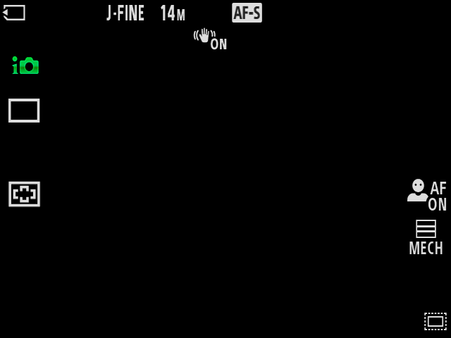
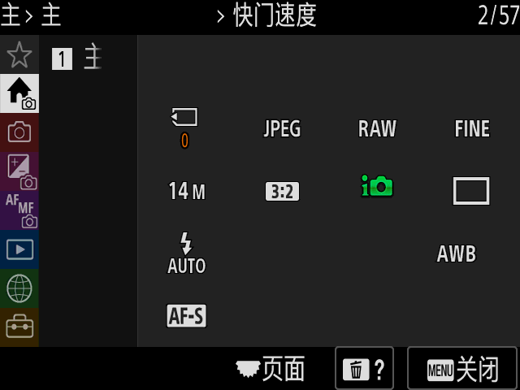

# 默认 start.sh 原冷启动与首帧等待修复

无参数 `./start.sh` 已在独立产品副本完成原中文首设、拍摄 HUD、原 MENU 进入／返回和正常保存退出。调用环境没有提供启动 profile、HCI、内部盘或其它功能覆盖。运行使用官方 2.01 ALLLANG BODYDATA 缓存和已构建的固定 QEMU 工件，内部盘从该副本的官方资产新建；没有读取研究仓库或系统 dump，也没有操作用户原窗口或实例。本轮未重做完整 QEMU 源码编译，因此不把它算作新的全量干净构建。

实际发现的产品问题是首个合成 LCD 的等待过短。原 runner 在首个 `FRAME_DRAW_RETURN` 后只再等 15 秒，但原 OSD 的合成、快照落地和 ramfb 显示可能尚未完成。失败的同一 guest 后来实际显示了原语言页，原 viewer 仍在运行，`/tmp` 也有 7,061,504 字节可用空间。修复只把首帧截止改为原冷启动观察预算的剩余时间；640×480、多色内容、原菜单像素、原输入释放和保存守卫保持。持续黑帧到总截止仍拒绝。

[机器可读收据](../../validation/default-original-cold-entry-20261109.json)记录本轮证据。较早的 [GTK ON、文件测试及同盘恢复](2026-11-09-original-cold-window.md)和 [CLI 冷链](2026-11-09-original-cold-boot.md)保留各自范围。

## 实际结果

| 项目 | 核对结果 |
| --- | --- |
| 真实入口 | `bash ./start.sh`，无参数、无功能环境覆盖；实际选择 `original-init-cold` |
| 官方输入 | BODYDATA SHA256 `eb4943e6099754d64deaef5047942e9bfe258f232d0b7bc39fa23b3cd10e1e31` |
| 原启动 | 原 kernel／RAM0；原 init → setup_rootfs → pivot_root → chroot → 旧根卸载／原 freeramdisk → 原 init2 → bootin／im／appFw |
| 原脚本 | 停止后从实际 RAM0／p7 独立抽取 init、init2、setup_rootfs、fstab.root、fstab、insmod_drv1／2，7 项完整 SHA 与官方绑定相同 |
| 显示和输入 | 原简体中文字形及唯一焦点、首设、HUD、原 MENU 控件像素和返回；每个请求都独立核原 App32 的按下／释放两边，保留 50ms |
| 保存 | 原设置同步、完整文件摘要、两个 bank；原 Fsys flush、虚拟卡读回和实际 CANCEL／CONT 恢复 |
| 内部盘 | 原内核 `freeze_bdev`，实际冻结 19 卷；停止后只读检查 10 个已挂载卷 |
| 正常退出 | WM_DELETE_WINDOW → 单次正常 QMP quit／rc0，owner 和 QEMU peer 消失后重新取得磁盘租约；VM signals 为空 |
| 集中检查 | 2 工作线程、2 组：cold／默认分派 59 通过、19 子测试；新增首帧回归 2 通过；GTK 38 通过；停止盘结构与跨通道内容通过 |

随后[产品集中检查](../../validation/product-cold-usb-integration-20261109.json)用两个工作线程核最终接线：host 383 通过／40 跳过／95 子测试，cold／USB 边界最终去重 115 通过／8 跳过／10 子测试，三段源码补丁身份和旧脚本同步均通过。第一次边界组的 18 个 USB 夹具继承长 TMPDIR，触发 AF_UNIX 路径超长；共享夹具改用短私有目录后，在原长 TMPDIR 环境复验 18 项全过。原失败和仅文档／来源元数据漂移分别留档，未重复未变 host／source 组。

10 卷中两个 ext2 的 `e2fsck -f -n` 返回 0；八个 VFAT 的 `fsck.fat -n` 返回 1，完整输出仅包含未卸载 dirty bit，原盘和抽取片均未修改。这里认证结构及内容，不能写成正常卸载或全部 fsck0。p2 的 Backup 由 host 从实际 FAT 片独立抽取，与最终 guest 保存摘要一致。






## 官方一致性的审查范围

本轮静态与动态证据分别成立：实际盘抽取的原脚本完整 SHA 不变；串口记录按顺序出现原 source、pivot_root、chroot、freeramdisk 读回、init2 与 bootin；mountinfo 证明 `/` 为 p7 ext2 只读，旧 `/initrd` 已卸载，`/usr` 来自 p15。shell 的 `/proc/$$/status` Uid／Gid 均为四列零。

原内核、原脚本和原相机业务程序通过显式虚拟设备及适配器运行。模拟器从原 kernel 入口开始，RAM0 有自有 bootstrap，p7 有受检查的适配项，CP／显示／存储等仍使用规定的功能模型。由此只能认定上述原用户态冷启动流程已实际消费，不能认定 BootROM、loader、原 CP、Sony WBI、watchdog 或全部硬件上电与官方机身完全一致。最终全链独立审查仍有这些未完成项。

## 失败、原因与保全

- 副本准备器首先把已经复制、字节相同的清单当作冲突拒绝；补成完整 SHA 比较后再允许复用。原错误与未完成副本保留。
- 两轮副本遗漏生成的 QEMU 身份收据、board DTB，前置阶段失败。补齐相同构建工件后再运行，没有从研究树取工件。
- 原首帧 15 秒超时保留为失败。保全同代全部 5 段实际 RAM：ELF 25,769,510,363 字节，SHA256 `b247b1377cf0b1229d7b149207282fe5c326d0522c0c7626bc7fa1a3393cad46`；段范围与实际 QMP memory tree 精确匹配。内部盘保全后一次正常 QMP quit，owner／peer 均退出，租约重新取得；SD 保存仍未认证。第一次保全解析遗漏 QMP 文本 CRLF，拒绝后保留原文件，再用新目录核齐，没有降低完整范围要求。
- 第一轮首帧修复候选已显示原语言页，但语言导航第 10 键的稳定图像等待超时。这轮设置、卡、19 卷冻结和正常退出通过，整体仍为失败。第二轮从同一停止盘实际重启，验收驱动逐帧留证并要求导航像素稳定 200ms 后再发下一键，最终闭环通过。这些是验收采样参数，不改变产品按键时长和原输入协议。
- 旧默认入口驱动只找 direct-bootin 的 `latest-menu-run.txt`；原冷链通过真实控制协议向 GTK 交付 run。修正测试发现本轮唯一 cold run；没有合成 guest ready、图像或原事件。

所有原始结果、失败盘、RAM、卡和私有窗口输出保留在本机 scratch，不进入公开代码。新收据不回填旧收据。

## 证据、结论与复现路径

| ID | 证据 | 结论 |
| --- | --- | --- |
| E1 | 收据 `evidence.actual`、`actual_ui.inputs`、3 张原 PNG | F1：真实默认窗口完成原 HUD／MENU 往返；原输入双边实际消费 |
| E2 | `evidence.cold_build`、`evidence.original_console`、7 个停止盘原脚本摘要 | F2：指定原用户态冷链与官方原脚本一致，适配范围显式保留 |
| E3 | `evidence.final_checks`、`stopped_disk`、`save_and_exit` | F3：本轮正常保存退出、结构和设置跨通道内容成立 |
| E4 | `preserved_failures.first_frame_failure_receipt` 与完整 RAM 摘要 | F4：原首帧等待过短；旧失败已保全并正常退出，不提升为通过 |

F1–F3 同时有运行日志、原像素／原文件和停止后独立检查。调用路径 P1 是：官方包导入 → 默认 start.sh → GTK ON → 原 kernel／RAM0／init／pivot／init2 → 原 AP 画面与输入 → 保存／冻结 → QMP 正常退出 → host 只读核盘。

第三方可按[根 README](../../README.md)先导入 BODYDATA、构建 QEMU，再执行 `./start.sh`，选择简体中文、完成首设，MENU 进入和返回，最后正常关闭并等待保存。自动 host 回归：

```bash
python3 -m pytest runtime/analysis/test_original_cold_boot.py \
  runtime/analysis/test_original_cold_launcher.py \
  runtime/analysis/test_bodydata_launch.py -q
xvfb-run -a -s '-screen 0 1600x1200x24' \
  python3 -m pytest runtime/analysis/test_camera_ui.py -q
```

本轮私有独立副本和完整失败 RAM 不公开，不能直接在他人机器重放原收据路径；公开收据提供完整摘要和各阶段判据。严格全部输入小于 100ms、热恢复、USB 功能选择／认证／root 和完整硬件启动仍分别未完成。完整 BODYDATA 更新和拍摄写卡按用户要求暂缓，recovery 暂停。
