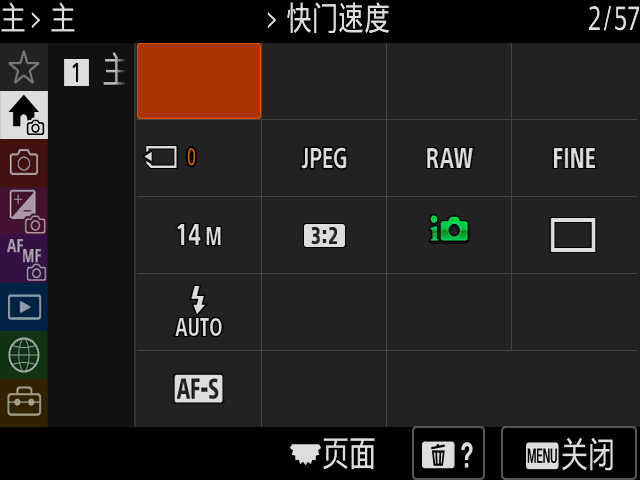
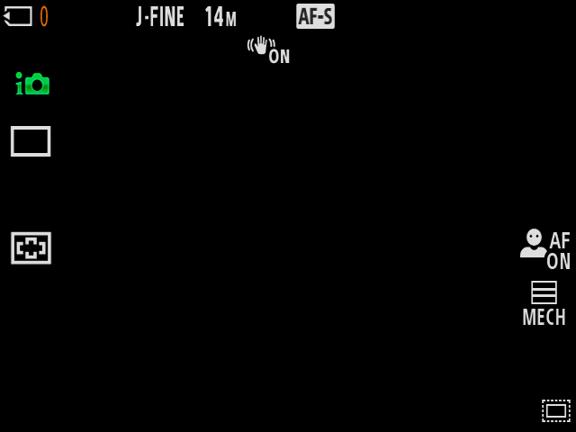

# 在相机窗口保存与恢复 RAM

固件开发面板已接入真实 QEMU RAM 保存和恢复。在停止态选择“QEMU RAM 会话（下次启动）”，ON 后可点击“保存 RAM 并退出”；只有设置、SD、原按键释放、19 卷冻结、RAM 数据和正常 QMP／owner 退出都完成，才允许“从 RAM 恢复”。恢复使用同一内部盘和源 RAM0／构建，不重新冷启动，也不重新铺盘。

实际同一 GTK 窗口完成了原中文首设、原 HUD、打开原 MENU、保存 RAM 并退出、同盘恢复原 MENU、新原 MENU 输入返回 HUD，以及目标设置／SD 保存和正常退出。该过程使用 QEMU migration；Sony 原 WBI、物理热启动和全部设备迁移审计分别未完成，不能因本功能通过提升它们。

## 使用

先按根 README 导入官方固件并构建普通产品，再准备独立 RAM 候选：

```bash
./build-qemu.sh --stage-only --sony-device --ram-state
./start.sh
```

成功构建会在本机生成 `source/ram-state-build.json`，登记产品内相对路径和实际 QEMU SHA。窗口停态勾选 RAM 会话时核该登记、persistent flash 和三个设备 VMState 的源码／生成源身份。默认已验 QEMU 二进制不被覆盖，不需要调用者手填 RAM 环境变量。若候选缺失或源码变化，窗口明确拒绝并保持停止态。

RAM 会话不启用 Sony USB 设备端；其完整设备／端点迁移尚未审计。普通 USB 服务会话和 RAM 会话分别运行。RAM 保存需要额外 5 GiB 流预算及至少 64 GiB 可用余量，输出在产品 `runtime/analysis/menu-runs/run-*/ram.qevm`；所有固件、磁盘、测试输出和 RAM 文件不放主机 `/tmp`。

恢复后原捕获选择即被消费，不能将后来已写入的内部盘与旧 RAM 捕获再次组合。RAM 文件和旧收据仍留作证据。选择固件文件或普通冷启动会清除当前可恢复选择，保持磁盘内容与 RAM 代次一致。

## 真实验收

[机器可读收据](../../validation/window-ram-20261109.json)及其原始证据摘要记录：

| 项目 | 结果 |
| --- | --- |
| 源和目标 | 原窗口 ON、RAM 模式、保存／恢复／OFF 均由真实鼠标点击；先滚动到控件并确认实际视口坐标 |
| 原输入 | 38 个实际机身输入请求、76 个原 App32 接收边，保留 50ms 按压／释放 |
| 源场景 | 原 MENU 打开时捕获；640×480 原 MENU 控件像素通过 |
| RAM 流 | 498,620,574 B；SHA256 `002bce6bc05e0bf3d32c2b7ed74702dbe8e196d2bc4eccf4191f40f6c98b623e`，完整 host 读回 |
| 同一 guest | boot_id 相同，uptime 104.17→104.31 秒；目标没有原 init／bootin 冷启动标记 |
| 原 LCD 续行 | 恢复初始 MENU 像素与捕获相同；恢复校验实际 MENU→HUD→MENU，窗口再次真实 MENU 返回 HUD |
| 内部盘 | 同设备／inode／长度；目标使用原捕获完整盘摘要和同一实例，恢复前后实际写入另记，不复用旧盘身份合同 |
| 恢复解冻 | 原内核 quiesce 实读 `0 0`，19 卷全部解冻后原 AP 消费输入 |
| 源和目标关闭 | 两轮真实设置／SD 导出、原 flush／CANCEL 恢复、19 卷 freeze；单次 QMP rc0、VM signals=[] |
| owner | 源3954399／peer3954417、目标3959201／peer3959219均退出，各轮租约重新取得 |
| 停止盘 | 两线程独立核10挂载卷结构和 p2 Backup 跨通道摘要；两个ext2 rc0，八个VFAT rc1仅dirty且未修盘 |
| host／GTK | 86项控制／RAM／cold／文件检查、6子测试；39项GTK及shell语法通过 |






## 生命周期和失败保护

窗口沿原控制socket发送保存请求，先释放触点，再完成设置／卡真实导出和内部卷冻结，最后才将 QEMU 数据经 SCM_RIGHTS 的 `fd:` 迁移写入私有普通文件。source postmigrate、流 magic／长度／完整摘要、原guest身份和全盘身份进入捕获收据。未完成迁移不发成功快照；失败保留原owner，不通过强杀释放租约。

目标先核私有捕获收据、源build、RAM0、QEMU、同一内部盘完整身份和摘要，再以 `-S -incoming defer` 启动。实际入流完成／paused、cont／running、原解冻、相同boot_id、无冷启动标记和新原 MENU 像素／输入通过后，才接回现有 GTK 连续 LCD 和输入协议。恢复时的原当前场景允许是 MENU 或 HUD，校验返回源场景，不假设源一定为HUD。

首次两个实际验收驱动点击了滚动视口外的RAM开关，均未启动guest。原失败收据保留，后续driver先滚动并核点击坐标在实际窗口内；该修复不改guest或QEMU。第三轮真实全周期通过，源/目标前后九份运行源码无漂移。host替身只验证接线，原AP验收和独立停止盘核收另立。

证据 E1 为实际窗口收据及原38请求/76边、三张原PNG；E2为源RAM捕获收据和目标same-boot／解冻／新MENU读回；E3为两轮原保存/退出/owner与停止盘核对。F1是同窗实际RAM恢复成立，F2是当前磁盘/流代次保护成立；路径P1为选RAM候选→原cold→原MENU→保存/冻结→RAM迁移→正常退出→同盘入流→解冻/原输入/像素→同窗操作→保存退出→host只读核盘。原WBI/完整硬件/物理ASIC/成片均保持未通过。
