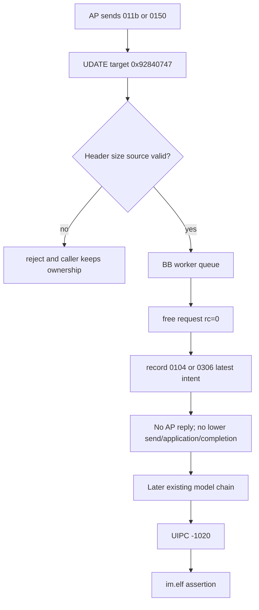

# BB 011b/0150 集成与第二十九跑报告

> 分析日期：2026-11-15
> 分析类型：固件虚拟运行链与 BB/UDATE 接收器逆向验证
> flavor：null
> 目标：A7C2 QEMU 的 BB 011b/0150 显示配置入口

## 执行摘要

本轮把候选补丁中的 BB `0x011b` 和 `0x0150` 精确集成到 A7C2 QEMU 的虚拟 UDATE/BB 接收器，并沿完整 guest preload、AArch64 KO、CPIO、production derive 链重建。宿主合同、AArch64 ABI、guest 资产绑定和产品回归均通过；CPIO 成员集合和模式保持不变，只有 `sony_udate_distribution.ko` 内容发生变化。两次独立 QEMU 运行都确认 AP 发出的 011b 和 0150 请求被真实接收、释放并写入对应的下层意图记录，未伪造 AP 回复或 VDF 完成。两次运行随后在既有后续链的 UIPC `-1020` 前沿进入 `im.elf` 断言，未到 broker、HUD、自然快门、JPEG 或 SD 写卡验收。该断言与本轮两条新入口的成功记录分离，当前不能把它归因于 011b/0150 补丁。

## Scope

范围、授权、网络和未覆盖的硬件行为见 [scope.md](../../../../scratch/a7c2-bb-remainder-integration-20261115-v4/scope.md)。时间线见 [timeline.md](../../../../scratch/a7c2-bb-remainder-integration-20261115-v4/timeline.md)。本轮只使用隔离 QEMU 和项目内虚拟盘，没有连接或写入真实相机、真实 SD 卡或物理设备。

## 实现内容

候选增加了两个独立的显示意图槽。`0x011b` 接受 10 字节请求，保留原 wire，按原 CP 逻辑把有效位归一化到 12 字节 `0x0104` lower intent；`0x0150` 接受 20 字节请求，检查两个选择器范围，保留偏移 16 的不透明参数，并构造 20 字节 `0x0306` lower intent。两条路径都在成功释放请求后提交 generation，保持 `lower_sent=0`、`applied=0` 和 `completion=0`，因为对应 VDF 后端尚未接入。内部 source `0x81b40549` 的 011b 完成协议仍明确拒绝，避免把 CP 内部合同吞成普通 AP 显示配置。

源码位置：

- [bb-receiver.c:24](/home/choco/Downloads/20261009sony7c2/final/a7c2-qemu/report/virtual-cp/udate-distribution/bb-receiver.c:24) 定义两个独立意图槽。
- [bb-receiver.c:87](/home/choco/Downloads/20261009sony7c2/final/a7c2-qemu/report/virtual-cp/udate-distribution/bb-receiver.c:87) 执行 011b/0150 的大小、选择器和 source 检查。
- [bb-receiver.c:186](/home/choco/Downloads/20261009sony7c2/final/a7c2-qemu/report/virtual-cp/udate-distribution/bb-receiver.c:186) 释放请求并记录 lower intent；日志明确保留后端未实现状态。

## 验证结果

| 层 | 结果 | 证据 |
|---|---|---|
| 候选静态审查 | 通过；无 P1/P2 集成阻塞 | [main-independent-review-v1.md](../../../../scratch/a7c2-bb-remainder-20261115-candidate1/main-independent-review-v1.md) |
| 宿主合同 | 48 场景通过，包含新命令、边界、所有权、free 失败、复用和并发 | [checks.json](../../../../scratch/a7c2-bb-remainder-20261115-candidate1/checks.json) |
| AArch64 ABI | 通过 | [checks.json](../../../../scratch/a7c2-bb-remainder-20261115-candidate1/checks.json) 与候选 `entrypoint-check/result.json` |
| guest 构建 | 通过；preload/KO 摘要绑定 | [integration-result.json](../../../../scratch/a7c2-bb-remainder-integration-20261115-v4/integration-result.json) |
| CPIO | 成员集合和模式不变，仅 `simulation/sony_udate_distribution.ko` 改变 | [cpio-delta.json](../../../../scratch/a7c2-bb-remainder-integration-20261115-v4/cpio-delta.json) |
| production derive | 通过；新 binding 为 `derive-prod-9bfcdccad5d2019f` | [derive-result.json](../../../../scratch/a7c2-bb-remainder-integration-20261115-v4/derive/derive-result.json) |
| 产品新测试 | 011b/0150 pytest 通过 | [new-product-regression.json](../../../../scratch/a7c2-bb-remainder-integration-20261115-v4/new-product-regression.json) |
| 既有回归 | UDATE/BB opcode 回归通过；0159 五个 C 测试场景通过 | [kernel-product-regression.json](../../../../scratch/a7c2-bb-remainder-integration-20261115-v4/kernel-product-regression.json)、[0159-complete.json](../../../../scratch/a7c2-bb-remainder-integration-20261115-v4/0159-complete.json) |

## 动态运行结果

正式运行和一次独立重试都通过了 QEMU 启动、guest 整卡 SHA 校验和正常退出纪律。正式运行的关键日志为：

```text
BB_K_DISPLAY_CONFIG: command=0x11b ... generation=1 ... request_freed=1 ap_reply=none ... lower_command=0x104 ... lower_sent=0 applied=0 completion=0
BB_K_DISPLAY_CONFIG: command=0x150 ... generation=1 ... request_freed=1 ap_reply=none ... lower_command=0x306 ... lower_sent=0 applied=0 completion=0
```

对应原始证据见 [正式运行 console.log:2052](/home/choco/Downloads/20261009sony7c2/scratch/a7c2-capture-p1-runtime-20261115-candidate29/run-1-evidence/console.log:2052) 和 [正式运行 console.log:2081](/home/choco/Downloads/20261009sony7c2/scratch/a7c2-capture-p1-runtime-20261115-candidate29/run-1-evidence/console.log:2081)；重试证据见 [retry console.log:2032](/home/choco/Downloads/20261009sony7c2/scratch/a7c2-capture-p1-runtime-20261115-candidate29-retry/run-1-evidence/console.log:2032) 和 [retry console.log:2043](/home/choco/Downloads/20261009sony7c2/scratch/a7c2-capture-p1-runtime-20261115-candidate29-retry/run-1-evidence/console.log:2043)。两个运行收据都记录 `guest_consumption_verified=true`、`runner_closed=true`、`disk_lease_retained_until_exit=true`、QEMU `returncode=0` 且没有发送信号。

两次运行随后都在后续链观察到 UIPC `-1020`，并在 `im.elf` 的 `lib_assert.cpp:46` 触发 `ASSERT_CALLER`。该异常发生在 011b/0150 日志之后；运行的直接失败状态是 `FirmwareFault`，而不是看门狗复位。由于当前日志没有把这笔 `-1020` 绑定到一个新的 011b/0150 请求，报告将其保留为后续模型前沿，不把它错误归因到本轮补丁。

## Evidence → Finding → Path

### Evidence

- **E1** / `scratch/a7c2-bb-remainder-20261115-candidate1/checks.json` / 复现：读取 JSON；content hash 以候选目录 `SHA256SUMS` 为准 / 候选 48 场景、ABI 和边界检查通过。
- **E2** / [integration-result.json](../../../../scratch/a7c2-bb-remainder-integration-20261115-v4/integration-result.json) / 复现：读取 JSON；`integration-result.json` SHA256 由任务目录读回 / 完整 guest 构建、CPIO 和 production derive 通过。
- **E3** / [正式 console.log:2052](../../../../scratch/a7c2-capture-p1-runtime-20261115-candidate29/run-1-evidence/console.log:2052) / 复现：`rg -n 'BB_K_DISPLAY_CONFIG' .../console.log`；console 原文件摘要保存在运行目录 / 011b 真实接收并释放，lower intent 为 0104，未声称完成。
- **E4** / [正式 console.log:2081](../../../../scratch/a7c2-capture-p1-runtime-20261115-candidate29/run-1-evidence/console.log:2081) / 同上 / 0150 真实接收并释放，lower intent 为 0306，未声称完成。
- **E5** / [正式 result.json](../../../../scratch/a7c2-capture-p1-runtime-20261115-candidate29/result.json) 和 [重试 result.json](../../../../scratch/a7c2-capture-p1-runtime-20261115-candidate29-retry/result.json) / 复现：读取 JSON；各文件 SHA256 可现场计算 / 两次 QEMU 皆正常 quit、rc0、无信号，业务在后续断言处失败。

### Findings

| Finding | 严重性 | Evidence | 置信度 | 位置 | 状态 |
|---|---|---|---|---|---|
| F1：011b/0150 候选已完成精确集成并被 guest 实际消费 | n/a_re | E1、E2、E3、E4 | high | `bb-receiver.c:87`、`:186` | 已验证 |
| F2：011b/0150 当前只记录意图，VDF0104/0306 后端仍缺失 | n/a_re | E2、E3、E4 | high | `bb-receiver.c:212` | 已验证并明确标注限制 |
| F3：后续 UIPC `-1020`/`im.elf` 断言仍是当前运行前沿 | n/a_re | E5、正式与重试 console | high | 两次运行 011b/0150 日志之后 | 未解决；未归因于本补丁 |

### Path

- **P1，path_type=callflow**：AP 构造 011b/0150 → UDATE 目标 `0x92840747` → 严格 header/size/source 校验 → BB 单 worker 接收 → `osal_free_msg` 成功 → 记录 0104/0306 latest intent → AP 无回复继续后续链。
- **P2，path_type=callflow**：后续 AP/模型命令 → 某笔 UIPC 发送返回 `-1020` → `im.elf` `lib_assert.cpp:46` → QEMU 运行停止接收按键。当前证据只能定位到这条后续路径，不能把它反推为 011b/0150 的文件损坏。



## 复现步骤

以下命令只读取或使用项目内隔离输入；第二十九跑会启动隔离 QEMU，不能改成真实设备操作：

```bash
# 宿主候选检查（已有最终收据；不会覆盖收据）
python3 -B -m pytest -q \
  final/a7c2-qemu/runtime/analysis/test_bb_remainder.py \
  -p no:cacheprovider

# 查看 guest 实际命中两条新入口
rg -n 'BB_K_DISPLAY_CONFIG|ASSERT_CALLER|ret = -1020' \
  scratch/a7c2-capture-p1-runtime-20261115-candidate29/run-1-evidence/console.log

# 查看绑定和 CPIO 变化
jq '{derive_dir,cpio_sha256,ko_sha256,original_CP_executed}' \
  scratch/a7c2-bb-remainder-integration-20261115-v4/integration-result.json
cat scratch/a7c2-bb-remainder-integration-20261115-v4/cpio-delta.json
```

完整重建入口和精确恢复清单在 [integrate.py](../../../../scratch/a7c2-bb-remainder-integration-20261115-v4/integrate.py) 与 [restore-manifest.json](../../../../scratch/a7c2-bb-remainder-integration-20261115-v4/restore-manifest.json)。

## 遗留问题与下一步

1. 连接 `VDF0104` 和 `VDF0306` 的真实独立消费者，逐笔验证 lower send、应用、通知和完成事件；当前 latest intent 不能升级为显示功能通过。
2. 为后续 UIPC `-1020` 记录目标、source、size 和原始 wire，先定位该发送者与对应模型 owner，再决定是否需要新的接收合同。
3. 继续运行前必须保持 `derive-prod-9bfcdccad5d2019f`、v4 恢复副本和两个唯一失败运行证据；不得把 QEMU 直接启动到原厂 loader/WBI 或真实相机。

## 资源收尾

本轮未访问物理设备、未发送信号、未保留活动 VM、lease 或 socket。三份与 v4 逐字节、模式和摘要相同的中间恢复树已安全回收，账本记录估算实际回收 `4,497,948,672` 字节；当前 v4 恢复副本、当前 derive、CPIO、guest KO、宿主检查和两次失败运行证据均保留。完整账本见 [storage-final.json](../../../../scratch/a7c2-bb-remainder-integration-20261115-v4/storage-final.json)，收尾后项目文件系统可用字节见该账本。

## 附件

- [候选说明](../../../../scratch/a7c2-bb-remainder-20261115-candidate1/README.md)
- [候选 48 场景收据](../../../../scratch/a7c2-bb-remainder-20261115-candidate1/checks.json)
- [v4 集成收据](../../../../scratch/a7c2-bb-remainder-integration-20261115-v4/complete-final.json)
- [正式运行收据](../../../../scratch/a7c2-capture-p1-runtime-20261115-candidate29/result.json)
- [独立重试收据](../../../../scratch/a7c2-capture-p1-runtime-20261115-candidate29-retry/result.json)
