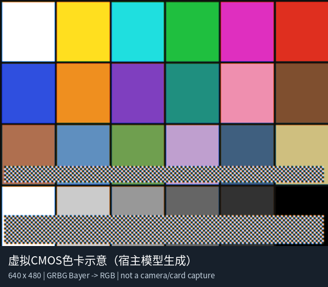

# 虚拟 CMOS 帧源

拍摄功能模型在 640×480 和 7008×4672 尺寸默认从本模块取得 Bayer 采样，再解马赛克为 RGB；不需要设置 `A7C2_VIRTUAL_CMOS_PROFILE`。该默认值属于拍摄功能模型，默认 `./start.sh` 的原厂窗口拍摄接线仍未完成。

本模块生成自产色卡：18 个彩色色块、6 级灰阶、深色间隔和两条细节方格。它不使用第三方图片或商用色卡的测量数据，也不是色彩校准目标。两个尺寸通过整数坐标缩放使用同一场景，再按各自像素的 GRBG CFA 选择通道；RGB 必须由这些 Bayer 样本解码，RAW 候选采样与 RGB 共享源。14 位样本左移两位保存在 `uint16_t` 中。它是软件功能模型，不代表原厂 CMOS、ISP 或 Sony ARW 的物理格式。

上图由 [`render_preview.py`](render_preview.py) 调用当前 `sensor_frame_rgb` 生成，底部文字仅用于展示标注；不是原厂程序写卡成片。历史写卡收据继续引用原样本，替换场景不会追溯改变旧证据。复现时将 `TMPDIR` 指向本项目任务目录后执行该脚本。

- `sensor_config_parse(NULL, ...)`：640×480；`"7008x4672"`：显式全像素配置；未知配置拒绝。
- `sensor_token_next` / `sensor_token_valid`：绑定配置代次与非零帧序号；序号耗尽返回 0，调用方需切换配置代次。
- `sensor_frame_bayer_into` / `sensor_frame_bayer`：采样帧，容量以样本数计算。
- `sensor_demosaic_rgb` / `sensor_frame_rgb`：按实际 GRBG 邻域生成 RGB24。
- `sensor_downsample`：整数方框降采样；调用方释放返回缓冲。

`../virtual-optics/optics.c` 是拍摄渲染消费者，`../../runtime/analysis/build-functional-camera-model.py` 将该模块编入模型并封存源码归档。`A7C2_VIRTUAL_CMOS_PROFILE=legacy-checker` 仅用于旧图案对照。

本批检查由 `test_sensor_core.py` 覆盖采样值、CFA 边界、代次、短缓冲拒绝与默认光学消费者：两线程集中验收共2582项通过。第107轮原厂程序实际消费默认CMOS帧，生成640×480 JPEG并写入虚拟卡，原文件读回、双整卡导出和独立解码均已核实；见[同轮收据](../../validation/default-cmos-runtime-20261120.json)。归档脚本误标模型路径的原失败独立保留，没有将整个后处理流程改记通过。

`test_sensor_core.py` 新增两个尺寸下的原始 CFA 色彩、RGB 色块、灰阶及边界验证；光学默认合同仍核对焦点模糊、曝光、步长、代次和 FNV。色卡场景尚未新跑原厂写卡；RAW 写卡、实时取景、录像及物理兼容性仍须分别验收。
